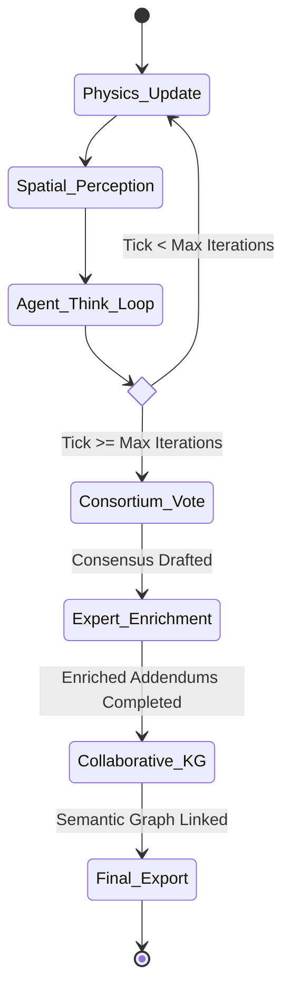
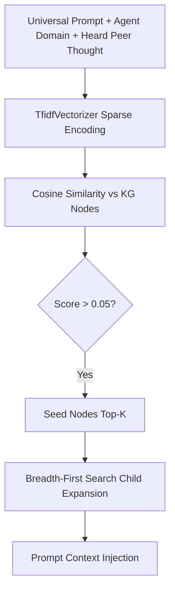

# Murmur Swarm 🌌

[](https://www.python.org/downloads/)
[](https://fastapi.tiangolo.com)
[](https://react.dev/)
[](https://github.com/langchain-ai/langgraph)
[](file:///Users/mike/Documents/code/Murmur_swarm/tests/)

**Murmur Swarm** is an advanced multi-agent intelligence platform that fuses **3D spatial flocking physics** with **agentic cognition**, **in-memory semantic Knowledge Graphs**, and **self-regulating synthetic organism dynamics**. 

Inspired by the collective murmurations of starlings, the platform replaces rigid turn-based loops and token-heavy fully-connected networks with an organic 3D simulation space. Agents move according to Reynolds Boids kinematics, and peer-to-peer communication is mediated by physical distance and auditory attenuation. Local sub-clusters debate and refine ideas before smoothly converging into rigorous global scientific consensus.

---

## 📑 Table of Contents

- [The Core Innovation: Spatial Cognition](#-the-core-innovation-spatial-cognition)
- [System Architecture & Lifecycle](#-system-architecture--lifecycle)
- [Key Cognitive & Physical Subsystems](#-key-cognitive--physical-subsystems)
  - [1. 3D Spatial Physics Engine](#1-3d-spatial-physics-engine)
  - [2. Multi-Provider LLM & Resiliency Layer](#2-multi-provider-llm--resiliency-layer)
  - [3. In-Memory Knowledge Graph & RAG Traversal](#3-in-memory-knowledge-graph--rag-traversal)
  - [4. Tripartite Synthetic Organism Governor](#4-tripartite-synthetic-organism-governor)
  - [5. Consensus, Expert Enrichment & Collaborative Synthesis](#5-consensus-expert-enrichment--collaborative-synthesis)
- [Dual Control Tower Interfaces](#-dual-control-tower-interfaces)
- [Project Directory Layout](#-project-directory-layout)
- [Quickstart & Installation](#-quickstart--installation)
- [FastAPI REST Endpoints](#-fastapi-rest-endpoints)
- [Documentation Catalog](#-documentation-catalog)

---

## 🕊 The Core Innovation: Spatial Cognition

In conventional Multi-Agent Systems (MAS), $N$ agents communicating in a shared context window generate an $O(N^2)$ token explosion that rapidly leads to context saturation, hallucination, and exorbitant API costs.

Murmur Swarm embeds agents as physical entities in a continuous 3D coordinate space ($[x, y, z]$). Proximity governs **Attention**: an agent only "hears" the thoughts of peers within its `visual_range`, with information volume attenuating quadratically via an **Influence Matrix**:

$$I(r, s) = \begin{cases} 
      \frac{1.0}{1.0 + \alpha \cdot d^2} & \text{if } d \leq \text{visual\_range} \\
      0.0 & \text{if } d > \text{visual\_range}
   \end{cases}$$

```mermaid
graph LR
    subgraph Active Local Cluster
        A["Agent A (Civil Eng)"] <-->|High Influence (d = 4.2)| B["Agent B (Materials)"]
    end
    C["Agent C (Macroeconomics)"] -.->|Auditory Threshold Muted (d = 38.1)| A
    C -.->|Auditory Threshold Muted (d = 35.4)| B
    
    style A fill:#1e293b,stroke:#38bdf8,stroke-width:2px,color:#fff
    style B fill:#1e293b,stroke:#38bdf8,stroke-width:2px,color:#fff
    style C fill:#1e293b,stroke:#ef4444,stroke-width:2px,color:#fff
```

Ideas must physically travel and gain momentum through the flock to reach the broader swarm. Specialized sub-groups debate intensely in local sub-spaces, filtering noise before merging into global consensus.

---

## 🏗 System Architecture & Lifecycle

The simulation lifecycle is coordinated by a deterministic, cyclic [LangGraph](https://github.com/langchain-ai/langgraph) state machine in [`core/swarm_orchestrator.py`](file:///Users/mike/Documents/code/Murmur_swarm/core/swarm_orchestrator.py):



1. **`Physics_Update`**: Computes separation, alignment, cohesion, and goal-seeking force vectors. Clamps speed and updates 3D positions using Euler integration.
2. **`Spatial_Perception`**: Computes pairwise Euclidean distances and populates the `influence_matrix`.
3. **`Agent_Think_Loop`**: Concurrent ReAct cycle. Agents assemble heard peer thoughts ($I(r, s) > 0.05$), execute in-memory TF-IDF context retrieval against local Knowledge Graphs, and generate reasoned contributions.
4. **`Consortium_Vote`**: Gathers all final agent thoughts and utilizes a lead model judge to draft a master consensus synthesis.
5. **`Expert_Enrichment`**: Sequentially routes the consensus document to each agent to enrich the research paper with domain-specific formulas, methodologies, and citations.
6. **`Collaborative_KG`**: Decomposes the enriched synthesis into a structured JSON Knowledge Graph, executes multi-pass agent node expansions, and performs semantic auto-linking.

---

## 🧠 Key Cognitive & Physical Subsystems

### 1. 3D Spatial Physics Engine
Located in [`core/swarm_physics.py`](file:///Users/mike/Documents/code/Murmur_swarm/core/swarm_physics.py), the physics engine calculates net acceleration $\vec{A}_{net}$ on each simulation tick:

$$\vec{A}_{net} = (w_s \cdot \vec{V}_s) + (w_a \cdot \vec{V}_a) + (w_c \cdot \vec{V}_c) + (w_g \cdot \vec{V}_g)$$

- **Separation ($\vec{V}_s$)**: Repels neighbors to prevent crowding, maintaining cognitive diversity.
- **Alignment ($\vec{V}_a$)**: Steers toward the average heading of local peers, aligning topic trajectories.
- **Cohesion ($\vec{V}_c$)**: Pulls toward the local center of mass, fostering coherent debate clusters.
- **Goal Seeking ($\vec{V}_g$)**: Magnetic pull toward origin `[0.0, 0.0, 0.0]`, tethering the swarm to the central objective.

### 2. Multi-Provider LLM & Resiliency Layer
Located in [`core/swarm_gemini.py`](file:///Users/mike/Documents/code/Murmur_swarm/core/swarm_gemini.py), [`core/swarm_nvidia.py`](file:///Users/mike/Documents/code/Murmur_swarm/core/swarm_nvidia.py), and [`core/swarm_ollama.py`](file:///Users/mike/Documents/code/Murmur_swarm/core/swarm_ollama.py), with flow control in [`core/rate_limiter.py`](file:///Users/mike/Documents/code/Murmur_swarm/core/rate_limiter.py) and [`core/llm_retry.py`](file:///Users/mike/Documents/code/Murmur_swarm/core/llm_retry.py):

- **Hot-Swappable Providers**: Seamless switching between **Google Gemini** (`google-genai` SDK), **NVIDIA NIM** (OpenAI compatible), and **Local Ollama** (`aiohttp` with DeepSeek thinking tag support).
- **Sliding-Window Rate Limiter**: Shared token and request throttling tracking RPM and TPM to avoid 429 quota exhaustion.
- **Exponential Backoff**: `@async_retry` decorator handling transient network or throttling errors.
- **Circuit Breaker**: Detects consecutive API failures and temporarily enters an Open state, allowing physical simulation to continue while isolating cognitive downtime.

### 3. In-Memory Knowledge Graph & RAG Traversal
Implemented in [`core/knowledge_graph.py`](file:///Users/mike/Documents/code/Murmur_swarm/core/knowledge_graph.py), eliminating heavy external database dependencies:



- **Dynamic Query Assembly**: Concatenates universal task, agent domain, and heard peer messages.
- **Sparse Vector Traversal**: Computes cosine angles between query and node summary vectors.
- **Topological BFS Expansion**: Expands top-scoring seed nodes down child edges up to `max_retrieval_depth` to provide holistic contextual memory.
- **Literature Ingestion**: Built-in integration with the **Directory of Open Access Books** ([`core/DOAB_client.py`](file:///Users/mike/Documents/code/Murmur_swarm/core/DOAB_client.py)) to search, retrieve, and ingest academic open-access monographs.

### 4. Tripartite Synthetic Organism Governor
Detailed in [`docs/synthetic_organism_spec.md`](file:///Users/mike/Documents/code/Murmur_swarm/docs/synthetic_organism_spec.md) and implemented in [`core/synthetic_organism.py`](file:///Users/mike/Documents/code/Murmur_swarm/core/synthetic_organism.py):

- **Invariant Manifold Anchoring (IMA)**: Evaluates representation drift against golden axiom embeddings using Lagrangian cosine constraints.
- **Topology-Aware Retrieval Morphing (TARM)**: Employs closed-form least-squares projection matrices (`DifferentiableProjectionLayer`) to translate legacy embeddings into evolved latent spaces.
- **Homeostatic Metabolic Governor (HMG)**: Tracks process memory tension (RSS) and applies synaptic scaling ($\gamma = 0.9$) and integer quantization down-casts.
- **Manifold Curvature Tearing**: Approximates singular value decomposition entropy to trigger speciation / cladogenesis when local representation spaces fracture.
- **Epistemic Validation Gate (EVG)**: Sandboxes candidate insights against baseline queries before promoting them into long-term memory.

### 5. Consensus, Expert Enrichment & Collaborative Synthesis
Once the spatial iterations conclude, the swarm produces publication-grade scientific output:
1. **Consortium Vote**: Synthesizes the core answer from all agents.
2. **Domain Enrichment**: Each agent performs an expert pass, adding technical formulas, experimental protocols, and domain critiques.
3. **Collaborative Graph Construction**: Extracts core taxonomies, executes agent-by-agent node additions, and executes semantic cross-linking.

---

## 🖥 Dual Control Tower Interfaces

Murmur Swarm provides two user interfaces:

### 1. Modern Web Control Tower (FastAPI + React 19)
- **Backend ([`backend.py`](file:///Users/mike/Documents/code/Murmur_swarm/backend.py))**: High-performance asynchronous FastAPI REST service.
- **Frontend ([`frontend/`](file:///Users/mike/Documents/code/Murmur_swarm/frontend/))**: Modern React 19 + TypeScript + Vite SPA.
  - Interactive **3D WebGL Boids Scatter Plot** via Plotly.js.
  - Timeline player with step-by-step playback scrubbers.
  - **Agent Forge**: Visual agent persona creation and PDF literature ingestion.
  - Real-time physics parameters and LLM rate-limit tuner.
  - DOAB academic library explorer.
  - Live WebSocket/polling system logs.
- **Launch Command**:
  ```bash
  python3 run_app.py
  ```

### 2. Streamlit Dashboard ([`app.py`](file:///Users/mike/Documents/code/Murmur_swarm/app.py))
- Single-command interactive Streamlit UI for rapid local experimentation:
  ```bash
  streamlit run app.py
  ```

---

## 📂 Project Directory Layout

```
Murmur_swarm/
├── core/                               # Core Python DSP and Cognitive Package
│   ├── DOAB_client.py                  # Directory of Open Access Books API client
│   ├── knowledge_graph.py              # KnowledgeArchitect (TF-IDF, BFS, RAG, MarkItDown)
│   ├── llm_retry.py                    # Exponential backoff retry decorators
│   ├── rate_limiter.py                 # Sliding-window RPM/TPM token-bucket limiter
│   ├── settings_manager.py             # Singleton settings & rate-limiter manager
│   ├── swarm_gemini.py                 # Google Gemini provider adapter (google-genai)
│   ├── swarm_io.py                     # Snapshot, agent config, and graph persistence
│   ├── swarm_logger.py                 # Central event logging system
│   ├── swarm_nvidia.py                 # NVIDIA NIM provider adapter (AsyncOpenAI)
│   ├── swarm_ollama.py                 # Local Ollama adapter (aiohttp REST)
│   ├── swarm_orchestrator.py           # LangGraph state machine & swarm coordinator
│   ├── swarm_physics.py                # 3D Boids kinematics & influence matrix
│   ├── swarm_schema.py                 # Pydantic v2 data models (Vector3, Snapshot, etc.)
│   └── synthetic_organism.py           # IMA, TARM, HMG, EVG, and manifold tearing
├── frontend/                           # React 19 + TypeScript + Vite Control Tower
│   ├── src/                            # React components, 3D Plotly visualizers, state
│   ├── package.json                    # Node dependencies
│   └── vite.config.ts                  # Vite build configuration
├── docs/                               # Comprehensive Technical Documentation
│   ├── README.md                       # Master Documentation Catalog & Hub
│   ├── murmur_swarm_overview.md        # Conceptual & Elevator Pitch
│   ├── swarm_architecture.md           # System Architecture & Topology
│   ├── theoretical_underpinnings.md    # Mathematical derivation of Spatial Boids
│   ├── llm_setup_and_multiagent_communication.md # Proximity protocols & provider setup
│   ├── llm_provider_integration.md     # Flow control, rate limiting, and retries
│   ├── knowledge_graph_mechanics.md    # Graph structure, JSON taxonomy, and traversal
│   ├── knowledge_graph_and_ltm_memory.md # RAG pipeline & long-term memory
│   ├── synthetic_organism_spec.md      # Synthetic Organism cognitive architecture
│   ├── agent_configuration.md          # Agent DNA, personas, and physics settings
│   ├── DOAB_API/DOAD_reference.md      # Academic literature ingestion API
│   └── specs/                          # System specifications (SPEC_01 to SPEC_05)
├── tests/                              # Pytest Automated Test Suite
│   ├── test_agent_tool_use.py
│   ├── test_dynamic_orchestration.py
│   ├── test_io_save.py
│   ├── test_knowledge_graph.py
│   ├── test_orchestrator.py
│   ├── test_physics.py
│   ├── test_rate_limiter.py
│   └── test_synthetic_organism.py
├── backend.py                          # FastAPI REST API Backend
├── run_app.py                          # Unified launcher (verifies deps, builds UI, runs API)
├── app.py                              # Alternative Streamlit Control Tower application
├── swarm_settings.json                 # Global configuration & environment definitions
└── requirements.txt                    # Python dependencies
```

---

## 🚀 Quickstart & Installation

### 1. Prerequisites
- **Python**: Version 3.11 or newer (Python 3.14 fully supported).
- **Node.js**: Version 18 or newer (required for the React Control Tower).
- **API Keys**: Google Gemini API key or NVIDIA NIM API key (or local Ollama).

### 2. Installation

1. Clone the repository:
   ```bash
   git clone https://github.com/AnimalGuide-MackHaber/Murmuration_swarm.git
   cd Murmuration_swarm
   ```

2. Set up a Python virtual environment:
   ```bash
   python3 -m venv .venv
   source .venv/bin/activate
   pip install -r requirements.txt
   ```

3. Configure your API keys in `swarm_settings.json` or as environment variables:
   ```bash
   export GEMINI_API_KEY="your-google-gemini-key"
   # or
   export NVIDIA_API_KEY="your-nvidia-nim-key"
   ```

### 3. Running the Application

#### Option A: Unified Control Tower (FastAPI + React 19)
Launch the launcher script, which automatically verifies backend dependencies, builds frontend assets if needed, and starts the server on `http://localhost:8501`:
```bash
python3 run_app.py
```
Open your browser to `http://localhost:8501`.

#### Option B: Streamlit Dashboard
```bash
streamlit run app.py
```

### 4. Running the Test Suite
Run the test suite with `pytest`:
```bash
python3 -m pytest tests/
```
All 20 test suites execute asynchronously, validating physics formulas, orchestrator transitions, knowledge graph traversals, and synthetic organism algorithms.

---

## 📡 FastAPI REST Endpoints

When running `backend.py`, the following REST endpoints are available:

| Endpoint | Method | Description |
| :--- | :--- | :--- |
| `/api/settings` | `GET`, `POST` | Inspect and update global physics, rate limit, and model settings. |
| `/api/agents` | `GET`, `POST` | List registered agents and create new agent configurations. |
| `/api/agents/{agent_name}` | `DELETE` | Remove an agent configuration. |
| `/api/agents/upload-pdf` | `POST` | Upload and decompose academic PDFs into knowledge graphs. |
| `/api/simulation/start` | `POST` | Initialize and begin a new swarm simulation run. |
| `/api/simulation/{sim_id}/step` | `POST` | Advance a single simulation tick. |
| `/api/simulation/{sim_id}/status` | `GET` | Retrieve live simulation state, 3D positions, and thoughts. |
| `/api/simulation/{sim_id}/synthesize` | `POST` | Trigger consortium voting and expert domain enrichment. |
| `/api/simulation/{sim_id}/generate-kg` | `POST` | Construct a collaborative knowledge graph from conclusions. |
| `/api/knowledge-graphs` | `GET` | List all available knowledge graph JSON datasets. |
| `/api/conclusions` | `GET` | Retrieve all finalized research papers and consensus documents. |
| `/api/doab/search` | `GET` | Query Directory of Open Access Books academic repository. |
| `/api/doab/download-and-ingest` | `POST` | Download open-access monograph and ingest into agent graph. |
| `/api/logs` | `GET`, `POST` | Inspect and clear real-time system logs. |

---

## 📖 Documentation Catalog

Explore the deep-dive technical documentation in [`docs/`](file:///Users/mike/Documents/code/Murmur_swarm/docs/):

- **[Documentation Catalog](file:///Users/mike/Documents/code/Murmur_swarm/docs/README.md)**: Master hub for all specifications and guides.
- **[Executive Overview](file:///Users/mike/Documents/code/Murmur_swarm/docs/murmur_swarm_overview.md)**: Conceptual pitch and value proposition.
- **[System Architecture](file:///Users/mike/Documents/code/Murmur_swarm/docs/swarm_architecture.md)**: Detailed component overview and state machine architecture.
- **[Theoretical Underpinnings](file:///Users/mike/Documents/code/Murmur_swarm/docs/theoretical_underpinnings.md)**: Mathematical derivation of Spatial Boids and attention attenuation.
- **[LLM Setup & Multi-Agent Communication](file:///Users/mike/Documents/code/Murmur_swarm/docs/llm_setup_and_multiagent_communication.md)**: Proximity communication mechanics and provider adapters.
- **[LLM Provider Integration & Resiliency](file:///Users/mike/Documents/code/Murmur_swarm/docs/llm_provider_integration.md)**: Rate limiting, backoff retries, and circuit breakers.
- **[Knowledge Graph Mechanics](file:///Users/mike/Documents/code/Murmur_swarm/docs/knowledge_graph_mechanics.md)**: TF-IDF indexing, JSON taxonomy, and collaborative synthesis.
- **[Knowledge Graph & Long-Term Memory](file:///Users/mike/Documents/code/Murmur_swarm/docs/knowledge_graph_and_ltm_memory.md)**: RAG search and topological BFS traversal.
- **[Synthetic Organism Specification](file:///Users/mike/Documents/code/Murmur_swarm/docs/synthetic_organism_spec.md)**: Tripartite self-regulating cognitive architecture (IMA, TARM, HMG, EVG).
- **[Agent Configuration Guide](file:///Users/mike/Documents/code/Murmur_swarm/docs/agent_configuration.md)**: Agent Forge and environment tuning guide.
- **[DOAB API Reference](file:///Users/mike/Documents/code/Murmur_swarm/docs/DOAB_API/DOAD_reference.md)**: Integration reference for academic literature ingestion.