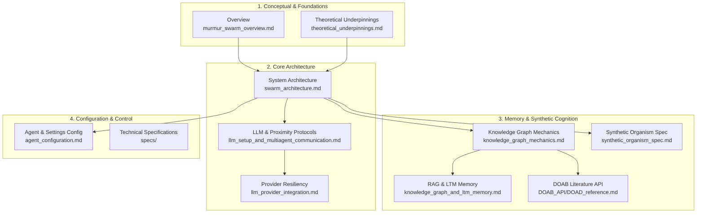

# Murmur Swarm Documentation Hub 📚

Welcome to the **Murmur Swarm** documentation library. This hub indexes the full technical and conceptual documentation for the multi-agent spatial physics and cognition platform.

---

## 🗺 Documentation Map

---

## 📑 Core Documentation Index

### 1. Conceptual & Foundations
- **[Executive Overview](file:///Users/mike/Documents/code/Murmur_swarm/docs/murmur_swarm_overview.md)**: High-level overview explaining how spatial physics mitigates the $O(N^2)$ context token scaling problem and drives emergent agent debates.
- **[Theoretical Underpinnings](file:///Users/mike/Documents/code/Murmur_swarm/docs/theoretical_underpinnings.md)**: Mathematical derivation of the 3D Boids algorithm (Separation, Alignment, Cohesion, Goal Seeking), Euler integration, and the quadratic auditory influence matrix.

### 2. Architecture & Communication
- **[System Architecture](file:///Users/mike/Documents/code/Murmur_swarm/docs/swarm_architecture.md)**: Comprehensive architectural breakdown of the presentation tier, LangGraph state machine, provider abstractions, and file responsibilities.
- **[LLM Setup & Multi-Agent Communication](file:///Users/mike/Documents/code/Murmur_swarm/docs/llm_setup_and_multiagent_communication.md)**: Detailed specification for proximity-gated communication channels, heard-thought assembly, consortium voting, and expert enrichment passes.
- **[LLM Provider Integration & Resiliency](file:///Users/mike/Documents/code/Murmur_swarm/docs/llm_provider_integration.md)**: Documentation of Google Gemini, NVIDIA NIM, and local Ollama integrations, backed by sliding-window token-bucket rate limiters (`RateLimiter`), exponential backoff retries (`@async_retry`), and circuit breakers.

### 3. Knowledge Graphs & Synthetic Cognition
- **[Knowledge Graph Mechanics](file:///Users/mike/Documents/code/Murmur_swarm/docs/knowledge_graph_mechanics.md)**: In-memory TF-IDF + Cosine similarity search, dynamic query assembly, top-K filtering, and 3-stage collaborative graph synthesis.
- **[Knowledge Graph & Long-Term Memory (LTM)](file:///Users/mike/Documents/code/Murmur_swarm/docs/knowledge_graph_and_ltm_memory.md)**: Complete lifecycle of agent long-term memory, sub-manifold querying, and topological BFS expansion.
- **[Synthetic Organism Specification](file:///Users/mike/Documents/code/Murmur_swarm/docs/synthetic_organism_spec.md)**: Technical blueprint for the self-regulating cognitive ecosystem:
  - Invariant Manifold Anchoring (IMA)
  - Topology-Aware Retrieval Morphing (TARM)
  - Speciation and Cladogenesis via Manifold Curvature Tearing
  - Homeostatic Metabolic Governor (HMG)
  - Epistemic Validation Gate (EVG)
  - Synthetic REM Sleep-State Recombination (SRR)
- **[DOAB API Reference](file:///Users/mike/Documents/code/Murmur_swarm/docs/DOAB_API/DOAD_reference.md)**: Integration guide for the Directory of Open Access Books API client, enabling academic literature ingestion.

### 4. Configuration & Technical Specifications
- **[Agent Configuration & Settings Management](file:///Users/mike/Documents/code/Murmur_swarm/docs/agent_configuration.md)**: Schema reference for `swarm_settings.json`, physics tuning weights, persona definitions, and REST endpoints.
- **[Specifications Directory](file:///Users/mike/Documents/code/Murmur_swarm/docs/specs/)**:
  - [`SPEC_01_CORE_SCHEMA.md`](file:///Users/mike/Documents/code/Murmur_swarm/docs/specs/SPEC_01_CORE_SCHEMA.md): Pydantic data models (`Vector3`, `AgentConfig`, `ChatMessage`, `SwarmSnapshot`).
  - [`SPEC_02_IO_AND_KNOWLEDGE.md`](file:///Users/mike/Documents/code/Murmur_swarm/docs/specs/SPEC_02_IO_AND_KNOWLEDGE.md): IO persistence and document chunking specifications.
  - [`SPEC_03_PHYSICS_ENGINE.md`](file:///Users/mike/Documents/code/Murmur_swarm/docs/specs/SPEC_03_PHYSICS_ENGINE.md): Force vector equations and kinematic clamping.
  - [`SPEC_04_ORCHESTRATION.md`](file:///Users/mike/Documents/code/Murmur_swarm/docs/specs/SPEC_04_ORCHESTRATION.md): LangGraph state machine node definitions.
  - [`SPEC_05_UI_DASHBOARD.md`](file:///Users/mike/Documents/code/Murmur_swarm/docs/specs/SPEC_05_UI_DASHBOARD.md): UI layout and 3D visual player specification.
  - [`high_level.md`](file:///Users/mike/Documents/code/Murmur_swarm/docs/specs/high_level.md): High-level system design overview.
  - [`implementation_spec.md`](file:///Users/mike/Documents/code/Murmur_swarm/docs/specs/implementation_spec.md): Step-by-step implementation guide.
