# Swarm Communication Flow

The Murmur Swarm achieves multi-agent collaboration not through a rigid, sequential pipeline, but through an organic, physically-mediated communication protocol managed by `swarm_orchestrator.py`. 

The communication lifecycle is divided into three major phases: **The Inner Loop (Simulation)**, **Consensus & Enrichment**, and **Knowledge Graph Synthesis**.

```mermaid
sequenceDiagram
    participant P as Physics Engine
    participant O as Orchestrator
    participant A as Agents (LLMs)
    participant K as Knowledge Architect

    rect rgb(40, 40, 40)
    Note over P,K: Phase 1: Inner Loop (Simulation)
    loop Every Iteration
        P->>P: Update Positions & Influence Matrix
        O->>A: Build Context (Memory + Heard Peers + KG)
        A-->>O: Generate Next Thought
    end
    end

    rect rgb(40, 40, 60)
    Note over P,K: Phase 2: Consensus & Enrichment
    O->>A: Aggregate all final thoughts (Vote)
    A-->>O: Raw Consensus Document
    O->>A: Sequential Domain Enrichment Pass
    A-->>O: Expert-Enriched Document
    end

    rect rgb(40, 60, 40)
    Note over P,K: Phase 3: KG Synthesis
    O->>K: Generate Base Graph from Text
    K-->>O: Base Graph (JSON)
    loop For each agent
        O->>A: Agent expands graph nodes
        A-->>O: Updated Graph
    end
    O->>K: Add final semantic linking edges
    end
```

## 1. The Inner Loop: Localized ReAct

During each iteration of the simulation, agents do not broadcast to the entire network. Instead, their communication is gated by their simulated physical proximity.

1. **Perception**: Based on the `influence_matrix` calculated by the physics engine, an agent scans its neighbors. If a neighboring agent's influence score is above the threshold (e.g., $0.05$), the agent successfully "hears" their latest thought.
2. **Context Assembly**: The orchestrator dynamically builds a contextual prompt for the agent containing:
   - The global universal prompt.
   - The agent's specific system instruction (domain of expertise and personality).
   - Knowledge Graph Context: Semantic retrieval query based on recently heard thoughts.
   - Internal Memory: The agent's last 5 private thoughts.
   - Extracted Peer Interactions: `"[Heard from Bob at dist 1.2]: I think we should optimize..."`
3. **Cognitive Generation (ReAct)**: The agent takes this unified context and generates its next unique contribution. Circuit breaking and retry logic with exponential backoff protect the loop against API rate limits and failures. This thought is saved as their `latest_thought` and broadcast to anyone nearby in the next iteration.

## 2. Consortium Vote and Expert Enrichment

Once the predefined number of maximum iterations is reached, the swarm transitions from localized chaos to global synthesis.

1. **Consortium Vote**: The orchestrator gathers the `latest_thought` (the final position) of every agent and submits them to the LLM in a grand aggregation prompt. The LLM acts as an impartial judge, ranking the top arguments and synthesizing a single **raw consensus statement**.
2. **Expert Enrichment Pass**: The raw consensus is then routed *back* through the individual agents sequentially.
   - Each agent reviews the global consensus through the lens of their specific domain (e.g., "Physics", "Chemistry", "Economics").
   - They inject relevant technical methodologies, specific citations, or structural refinements into the document.
   - Crucially, they are instructed *not* to overwrite the contributions of other experts. 

The result is a highly detailed, globally aligned document that possesses deep technical rigor from multiple angles.

## 3. Collaborative Knowledge Graph Synthesis

To capture the data in a machine-readable, persistent format, the enriched consensus undergoes structured graphing:

1. **Base Graph Generation**: First, a foundational Knowledge Graph is extracted from the consensus text using the `KnowledgeArchitect`.
2. **Agent Enrichment**: The JSON representation of this graph is passed to each agent. Agents are asked to expand nodes, inject child concepts, and deepen the tree structure with domain-specific knowledge that might not have made it into the raw text.
3. **Automated Linking**: Finally, the `KnowledgeArchitect` performs a sweeping pass across the enriched graph to establish semantic edges linking disparate concepts that the agents introduced. 

This resulting graph becomes part of the system's persistent memory, ready to be recursively injected into future `Context Assembly` phases.
