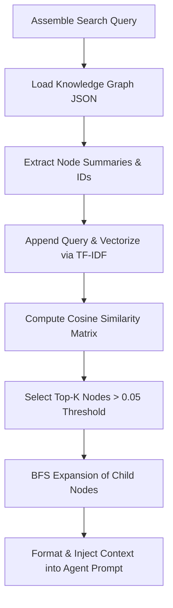
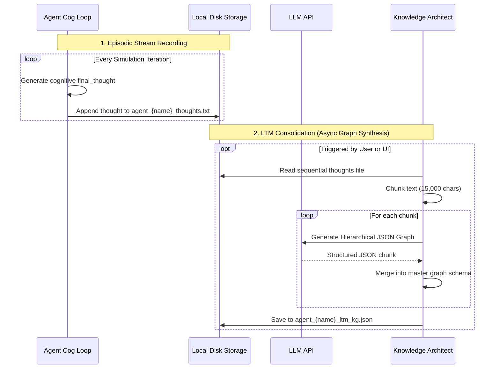

# Knowledge Graph Retrieval & Long-Term Memory Mechanics

This document provides a detailed technical specification of the Knowledge Graph (KG) retrieval mechanism and the Long-Term Memory (LTM) lifecycle in the Murmur Swarm codebase.

---

## 1. Knowledge Graph Retrieval Architecture

Rather than relying on external vector databases, the swarm implements a localized, in-memory **Semantic Retrieval & Expansion Engine** inside the [KnowledgeArchitect](file:///Users/mike/Documents/code/Murmur_swarm/core/knowledge_graph.py) class. This engine performs sparse vector search combined with graph topology traversal to inject relevant context into the agents' cognitive prompts.

### The Retrieval Pipeline

The retrieval process occurs during each simulation tick inside the `agent_think` node. It consists of the following key steps:



### Step-by-Step Breakdown

#### 1. Query Formulation
The orchestrator gathers query inputs from the active simulation state to form a context-rich search string:
```python
query_sources = [state.universal_prompt, config.domain, recent_thought]
search_query = " ".join([q for q in query_sources if q.strip()])
```
- **Universal Prompt**: The global swarm objective.
- **Domain**: The agent's specific area of expertise (e.g., "Structural Engineering").
- **Recent Thought**: The latest message heard from peer agents (via spatial proximity).

#### 2. TF-IDF & Cosine Similarity Matching
The [KnowledgeArchitect.retrieve_context](file:///Users/mike/Documents/code/Murmur_swarm/core/knowledge_graph.py#L441-L542) method runs the vector search:
- **Vectorizer**: Uses `scikit-learn`'s `TfidfVectorizer` configured with English stop-words removal:
  ```python
  vectorizer = TfidfVectorizer(stop_words='english')
  tfidf_matrix = vectorizer.fit_transform(documents)
  ```
- **Cosine Similarity**: Measures the cosine angle between the query vector (the last row of the matrix) and each node summary vector:
  $$\text{Similarity}(\mathbf{u}, \mathbf{v}) = \frac{\mathbf{u} \cdot \mathbf{v}}{\|\mathbf{u}\| \|\mathbf{v}\|}$$
  ```python
  cosine_sims = cosine_similarity(tfidf_matrix[-1], tfidf_matrix[:-1]).flatten()
  ```
- **Filtering**: Retains nodes with a similarity score exceeding `0.05` to filter out irrelevant noise.

#### 3. Topological BFS Expansion
To ensure that retrieval fetches not just isolated facts but complete conceptual contexts, the engine performs a **Breadth-First Search (BFS)** starting from the top-scoring nodes (up to `top_k`, default 3):
- **Depth Limit (`max_retrieval_depth`)**: Restricts how deep the traversal goes (default: 1).
- **Fan-Out Limit (`max_children_per_node`)**: Restricts the maximum number of child nodes traversed per node (default: 3).
- **Traversal Logic**:
  ```python
  while head < len(queue):
      curr_id, curr_depth = queue[head]
      head += 1
      
      if curr_depth < max_depth:
          node_data = nodes.get(curr_id)
          if node_data and "children" in node_data:
              child_count = 0
              for child_id in node_data["children"]:
                  if child_count >= max_children_per_node:
                      break
                  if child_id in nodes and child_id not in visited:
                      child_node = nodes[child_id]
                      summary = child_node.get("summary", "")
                      if summary:
                          visited.add(child_id)
                          retrieved_chunks.append(f"[{label}] (Connected): {summary}")
                          queue.append((child_id, curr_depth + 1))
                          child_count += 1
  ```

---

## 2. Long-Term Memory (LTM) Lifecycle

The Long-Term Memory of a Murmur Swarm agent is split into two operational modes: **Episodic Stream Recording** (live simulation) and **Consolidated Knowledge Graph Synthesis** (offline compilation).



### 1. Episodic Stream Recording
As the simulation ticks forward, the agent's cognitive thoughts are captured in real-time. If the thought is a valid reasoning step (i.e. does not start with error or thinking-state placeholders), it is appended to the agent's raw thoughts stream:
- **Storage Path**: `swarm_data/agents/{agent_name}/agent_{safe_name}_thoughts.txt`
- **Method**: [SwarmIO.append_agent_thought](file:///Users/mike/Documents/code/Murmur_swarm/core/swarm_io.py#L230-L239)

### 2. Consolidated Knowledge Graph Synthesis
Raw text thoughts are highly redundant. To transform them into a searchable memory, they must be consolidated. This is triggered in [app.py](file:///Users/mike/Documents/code/Murmur_swarm/app.py#L1053-L1083) (for a single agent) or [app.py](file:///Users/mike/Documents/code/Murmur_swarm/app.py#L1090-L1174) (globally for all agents).

- **Pipeline**:
  1. **Ingest & Chunk**: Reads the thoughts text file and splits it into chunks of approximately `chunk_size` characters (default: 15,000 characters).
  2. **LLM Structuring**: Each chunk is processed by the active LLM provider using a structural prompt directing the LLM to model the data into nodes representing a hierarchical taxonomy:
     - Root Domain (Agent Profile)
     - Core Concepts
     - Sub-concepts
     - Atomic Facts
  3. **Graph Merging**: The partial graphs generated from each chunk are merged using `_merge_graphs`:
     - New nodes are added.
     - Existing nodes append new children to their `children` arrays, avoiding duplicates.
  4. **Persist LTM**: The consolidated graph is saved to `swarm_data/agents/{agent_name}/agent_{safe_name}_ltm_kg.json`.

### 3. Long-Term Memory Retrieval
When an agent starts its cognitive process in subsequent simulations, the orchestrator checks if `search_long_term_memory` is enabled:
- It resolves the path via [SwarmIO.get_agent_ltm_kg_path](file:///Users/mike/Documents/code/Murmur_swarm/core/swarm_io.py#L256-L260).
- If the LTM KG exists, it calls `retrieve_context` using the active search query.
- The retrieved context is formatted and injected into the system prompt inside a dedicated section:
  ```
  --- LONG TERM MEMORY ---
  [Concept A]: Summary of historical thought...
  [Concept B] (Connected): Detail...
  ```

---

## 3. Knowledge Graph Data Schema

All Knowledge Graphs (including static domain KGs and generated agent LTM KGs) conform to a strict, typed JSON schema managed by [AgentConfig](file:///Users/mike/Documents/code/Murmur_swarm/core/swarm_schema.py#L38-L61) and loaded by [KnowledgeArchitect](file:///Users/mike/Documents/code/Murmur_swarm/core/knowledge_graph.py).

### Schema Specification
```json
{
  "nodes": {
    "node_id": {
      "label": "String",
      "summary": "String",
      "type": "concept | fact",
      "children": [
        "child_node_id_1",
        "child_node_id_2"
      ]
    }
  }
}
```

### Schema Parameters

| Parameter | Type | Description |
| :--- | :--- | :--- |
| `nodes` | `Object` | Key-value store mapping unique string identifiers to node data. |
| `node_id` | `String` | Unique identifier (e.g., `"quantum_entanglement"`). |
| `label` | `String` | Human-readable name of the concept or fact. |
| `summary` | `String` | Textual definition, details, or historical context. Target of TF-IDF vectorization. |
| `type` | `String` | Categorizes the node. Constrained to either `"concept"` or `"fact"`. |
| `children` | `Array[String]` | List of node IDs linked as hierarchical or semantic descendants. Used for BFS expansion. |

### Concrete LTM KG Example
```json
{
  "nodes": {
    "agent_Complexity_Agent_007_ltm_kg": {
      "label": "agent_Complexity_Agent_007_ltm_kg",
      "summary": "Root node for agent_Complexity_Agent_007_ltm_kg",
      "type": "concept",
      "children": [
        "cellular_automata",
        "emergence"
      ]
    },
    "cellular_automata": {
      "label": "Cellular Automata",
      "summary": "Discrete dynamical systems defined on a grid of cells that evolve according to local transition rules.",
      "type": "concept",
      "children": [
        "rule_30"
      ]
    },
    "rule_30": {
      "label": "Rule 30",
      "summary": "A 1D cellular automaton rule displaying chaotic dynamics, used to model complex physical structures.",
      "type": "fact",
      "children": []
    },
    "emergence": {
      "label": "Emergence",
      "summary": "The phenomenon where complex global behaviors arise from simple local agent interactions.",
      "type": "concept",
      "children": []
    }
  }
}
```

---

## 4. Key Libraries Involved

The Knowledge Graph and LTM functionality rely on the following primary libraries:

1. **`scikit-learn`** (`sklearn`):
   - `TfidfVectorizer`: Tokenizes summaries, removes stop words, computes term frequencies, and transforms text into sparse TF-IDF vectors.
   - `cosine_similarity`: Performs fast matrix multiplication to compute similarity scores between the query and all node summaries.
2. **`markitdown`** (`MarkItDown`):
   - Ingests incoming PDF documents, parses formatting structure, and converts them to plain text during domain KG generation.
3. **`pydantic`** (`BaseModel`):
   - Validates JSON schemas and parses database records dynamically.
4. **`asyncio`**:
   - Handles concurrent reading, writing, and parallel async API calls during multi-agent memory retrieval and consolidation.
