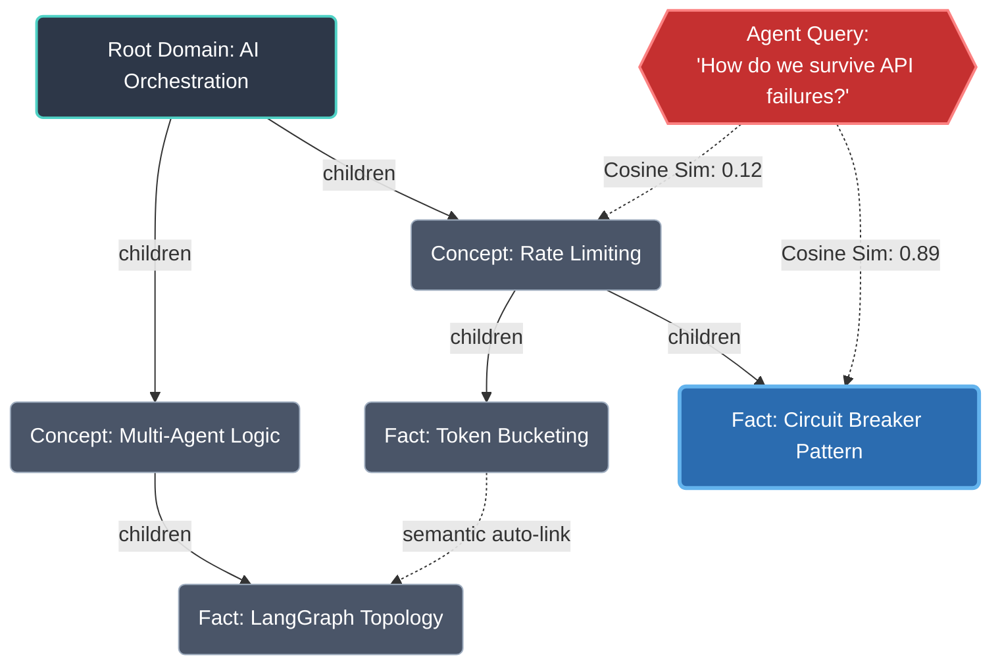

# Knowledge Graph Mechanics

Murmur Swarm fundamentally shifts AI memory structures. Instead of relying purely on linear conversational history, the agents dynamically build, traverse, and query **Knowledge Graphs (KGs)**. The `KnowledgeArchitect` (`knowledge_graph.py`) handles semantic traversal, graphing, and data synthesis.

## 1. Dynamic Retrieval (The Context Injection Phase)

During the `agent_think` phase, the Orchestrator doesn't just hand the agents their raw chat logs. If an agent is configured with a specific `knowledge_graph_path`, the Orchestrator executes a dynamic **Semantic Retrieval Loop**.

Instead of utilizing heavy reliance on external vector databases like Pinecone, Murmur Swarm utilizes an aggressive, in-memory **TF-IDF & Cosine Similarity** matrix algorithm to match recent thoughts against the entire Knowledge Graph tree.

1. **Query Construction**: The orchestrator concatenates the `universal_prompt`, the agent's `domain`, and the `recent_thought` of the peer they are currently "listening" to.
2. **Vectorization**: The `TfidfVectorizer` transforms all the `summary` strings of the nodes in the agent's graph, alongside the query, into a sparse matrix.
3. **Cosine Similarity**: The system calculates the dot product angle between the query vector and all node vectors.
4. **Context Injection**: The Top-$K$ (default 3) nodes that exceed a strict threshold ($> 0.05$) are surgically injected directly into the agent's system prompt prior to the ReAct execution.

This allows the agent to essentially "remember" dense facts only when the spatial conversation shifts towards that specific topic.

## 2. Collaborative Swarm Graphing (Phase 3 Synthesis)

Once a simulation ends, Murmur Swarm writes its unified consensus into an evolving Knowledge Graph format. This is computationally expensive but vital for system-wide incremental learning.

The pipeline executes in three autonomous steps:

### A. Base Extraction
The `KnowledgeArchitect` asks the LLM to extract a "skeleton" hierarchy from the raw consensus text. This defines the foundational nodes.

### B. Sequential Agent Node Expansion
The JSON graph is then passed around the swarm. The system executes a `_merge_graphs` function. As the LLM iterates as "Dr. Chemistry" or "Dr. Economics," it expands the JSON tree, defining new granular nodes, facts, conceptual definitions, and injecting them seamlessly into the master document.

### C. Semantic Auto-Linking
When multiple agents expand a graph, it often becomes heavily fragmented. The final step is `add_linking_edges`. The LLM scans the entirety of the newly constructed graph to locate disparate concepts that share semantic value and explicitly updates the `children` arrays, bridging the gaps between isolated domains.

## 3. The Structural JSON Schema

The underlying architecture relies on a strictly typed JSON structure. Every valid Knowledge Graph inherently obeys this taxonomy:

```json
{
  "nodes": {
    "node_id_1": {
      "label": "Quantum Entanglement",
      "summary": "A physical phenomenon that occurs when a group of particles are generated or interact...",
      "type": "concept",
      "children": ["node_id_4", "node_id_12"]
    },
    ...
  }
}
```

### Visualizing Structure and Traversal

The diagram below visualizes how this JSON translates into a directed graph, and how the TF-IDF Matrix traverses it during an active simulation.



By constraining the output to this schema during Phase 3, the resulting documents can be recursively dropped back into `swarm_data/` to act as the source nodes for future swarm iterations without external formatting scripts.
