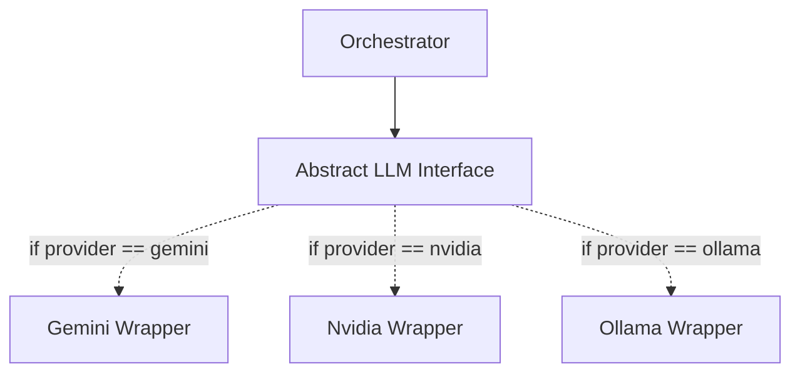

# LLM Provider Integration & Resiliency

Murmur Swarm is extremely token-hungry by design. To mitigate the architectural stresses of orchestrating multiple synchronous LLM calls every iteration, the system uses a robust abstraction tier for its models, paired with aggressive rate limiters and circuit breakers.

## Hot-Swappable LLM Tier

Instead of hard-coding API calls to a single provider, Murmur relies on an abstracted `LLMProvider` interface. The Orchestrator can dynamically hotswap the active model without dropping the simulation state.

The system natively supports:
1. **Gemini** (`swarm_gemini.py`): Leverages Google's `google-genai` SDK. Highly performant for complex contextual reasoning.
2. **Nvidia NIM** (`swarm_nvidia.py`): Routes commands to Nvidia's hosted inference APIs. 
3. **Ollama** (`swarm_ollama.py`): Connects to localized models running on-premise, bypassing cloud token costs and latency entirely for privacy-first operations.

## Token Economics and Flow Control

Running multi-agent simulations places massive strain on external APIs. If 5 agents trigger a 2000-token prompt per iteration over 10 iterations, the system can instantly hit HTTP 429 Rate Limit boundaries.

To handle this, Murmur Swarm implements two critical mechanisms in its orchestration loop:

### 1. Token Bucket Rate Limiting
Stored in `rate_limiter.py`, the system tracks both `requests_per_minute` and `tokens_per_minute` using a leaky-bucket algorithm. Before an agent fires its ReAct prompt, it estimates the token payload ($Tokens_{est} \approx \frac{len(text)}{4}$). The rate limiter forces an `asyncio.sleep` if generating the thought would breach the configured ceiling for the active provider.

### 2. Circuit Breaking
If an API fails consecutively (e.g., due to an outage, bad network connection, or hard throttling), Murmur will not infinitely stall in an error loop. 

A Circuit Breaker tracks `failure_count`. If it exceeds a configured threshold (e.g., 5 sequential failures), the circuit "Opens".
- While Open, all LLM calls are instantly bypassed and replaced with a static string `"(Thinking paused: Circuit Breaker Open)"`.
- The simulation loop continues physically moving the agents, representing a momentary cognitive blackout for the swarm.
- After an `open_duration_seconds` cool-down, the circuit "Half-Opens" and allows the swarm to try reasoning again.

This unique combination of physical stalling and algorithmic tracking ensures the Swarm can survive highly unpredictable external environments gracefully.
