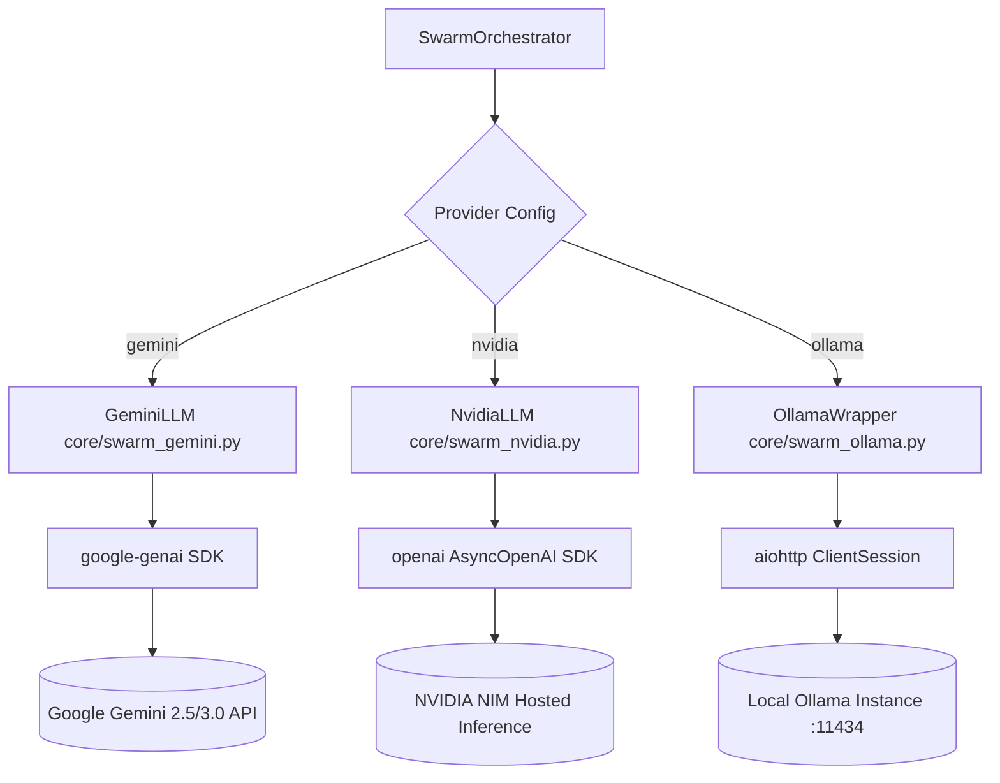
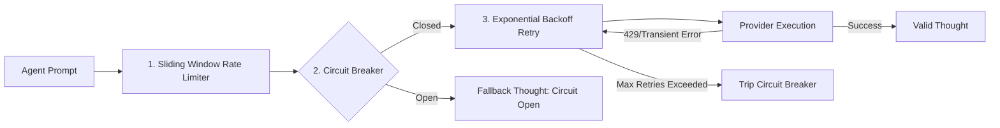

# LLM Provider Integration & Resiliency Tier

**Murmur Swarm** is designed to execute high-concurrency multi-agent cognitive simulations without suffering from API rate-limit exhaustion, network dropouts, or vendor lock-in. It provides hot-swappable model adapters abstracted behind a unified interface with built-in sliding-window rate limiting, exponential backoff retries, and circuit breakers.

---

## 1. Provider Adapter Architecture

All providers implement an asynchronous `generate_content_async(prompt: str) -> GenerationResponse` interface located in the `core/` package:



### Supported Providers

| Provider | Adapter Module | Underlying SDK | Key Features |
| :--- | :--- | :--- | :--- |
| **Google Gemini** | [`core/swarm_gemini.py`](file:///Users/mike/Documents/code/Murmur_swarm/core/swarm_gemini.py) | `google-genai` | Native async client (`client.aio.models.generate_content`), dynamic model introspection filtering for `generateContent` support, token usage metadata parsing. |
| **NVIDIA NIM** | [`core/swarm_nvidia.py`](file:///Users/mike/Documents/code/Murmur_swarm/core/swarm_nvidia.py) | `openai` (`AsyncOpenAI`) | Direct integration with NVIDIA inference microservices (`https://integrate.api.nvidia.com/v1`), high-throughput reasoning models like Llama-3.3-70B-Instruct. |
| **Local Ollama** | [`core/swarm_ollama.py`](file:///Users/mike/Documents/code/Murmur_swarm/core/swarm_ollama.py) | `aiohttp` | Completely offline execution, zero token fees, local hardware acceleration, native support for DeepSeek reasoning tags (`"think": true`). |

---

## 2. Resiliency & Flow Control Mechanisms

Running a simulation with $M$ agents across $N$ iterations generates $M \times N$ cognitive prompts plus consensus and enrichment rounds. Without flow control, this quickly triggers HTTP `429 Too Many Requests` or context quota penalties. Murmur Swarm mitigates this via three layers:



### 1. Sliding-Window Rate Limiting ([`core/rate_limiter.py`](file:///Users/mike/Documents/code/Murmur_swarm/core/rate_limiter.py))
- Shared instance managed by `SettingsManager` per provider key.
- Tracks dual ceilings:
  - **RPM (Requests Per Minute)**
  - **TPM (Tokens Per Minute)**
- Uses a double-ended timestamp queue (`collections.deque`).
- Before sending a prompt, the orchestrator estimates token weight:
  $$\text{Tokens}_{est} = \max\left(10, \frac{\text{len}(\text{prompt})}{4}\right)$$
- If either RPM or TPM would exceed configured limits, `RateLimiter.acquire()` computes the necessary wait time and pauses execution via `await asyncio.sleep(wait_time)`.
- When the API responds with actual token usage metadata, `RateLimiter.update_usage()` reconciles the queue with true token counts.

### 2. Exponential Backoff Retries ([`core/llm_retry.py`](file:///Users/mike/Documents/code/Murmur_swarm/core/llm_retry.py))
- Asynchronous API calls are decorated with `@async_retry(max_retries=10, base_delay=2.0)`.
- Inspects exception messages for transient indicators (HTTP `429`, `503`, `rate limit`, `ResourceExhausted`, `timeout`, `connection reset`).
- Backs off exponentially:
  $$\text{Delay}(k) = \text{base\_delay} \cdot 2^k \pm \text{jitter}$$
- Non-transient exceptions (e.g., authentication failures) fail fast without wasted retries.

### 3. Circuit Breaker Pattern
- Implemented within `SwarmOrchestrator` to prevent deadlocks and excessive billing during persistent service outages.
- Tracks sequential failures (`failure_count`).
- If failures exceed `max_failures` (default: 15), the circuit trips to **Open** for `open_duration_seconds` (default: 600s).
- During the open phase, LLM calls are skipped immediately, returning:
  `"(Thinking paused: Circuit Breaker Open)"`
- The physics engine continues moving agents, visually indicating a cognitive freeze while maintaining spatial continuity. After the cool-down expires, the circuit enters **Half-Open** to test connectivity.

---

## 3. Configuration & Hot Swapping

LLM providers can be switched dynamically via the UI (Settings panel or API endpoint `POST /api/settings`) without restarting the simulation. 

Example configuration in `swarm_settings.json`:

```json
{
  "llm_provider": "gemini",
  "model_name": "gemini-2.5-flash",
  "gemini_api_key": "YOUR_API_KEY",
  "nvidia_api": {
    "api_key": "YOUR_NVIDIA_KEY",
    "base_url": "https://integrate.api.nvidia.com/v1"
  },
  "ollama": {
    "base_url": "http://localhost:11434",
    "think": true
  },
  "rate_limiting": {
    "gemini": {
      "requests_per_minute": 60,
      "tokens_per_minute": 100000,
      "request_delay_seconds": 0.5
    },
    "nvidia": {
      "requests_per_minute": 30,
      "tokens_per_minute": 60000,
      "request_delay_seconds": 1.0
    },
    "ollama": {
      "requests_per_minute": 120,
      "tokens_per_minute": 200000,
      "request_delay_seconds": 0.1
    }
  }
}
```
