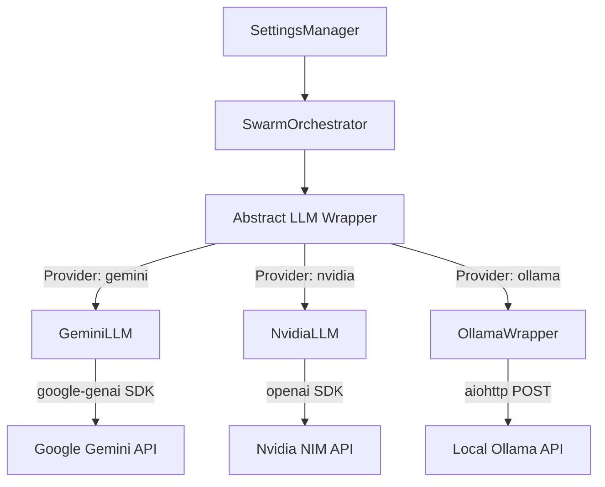
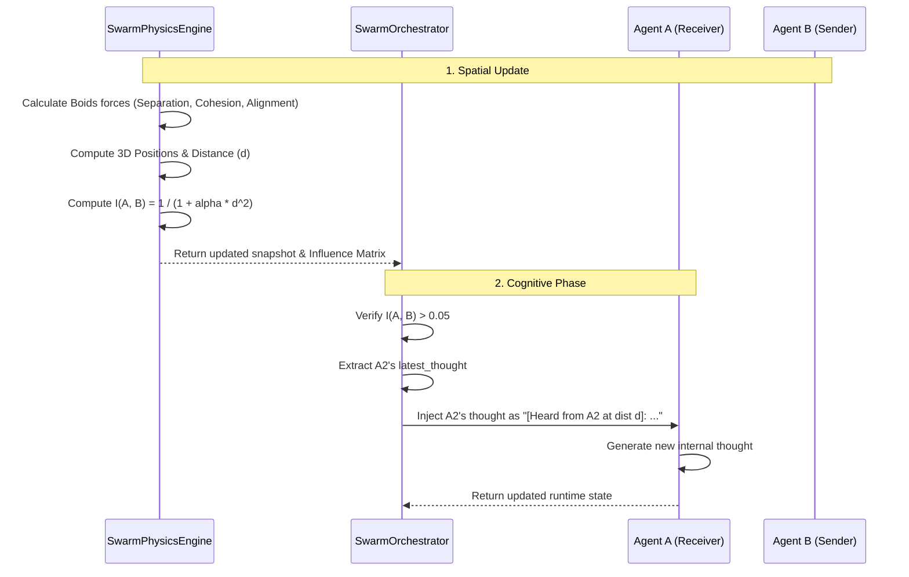
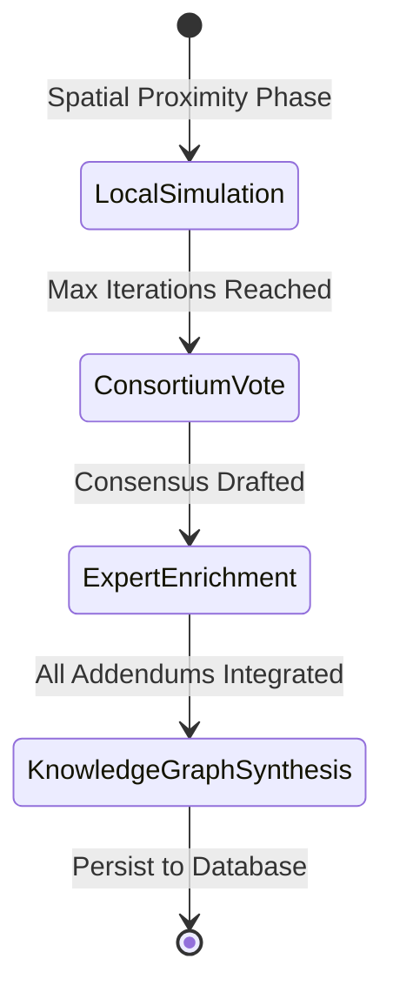

# LLM API Setup & Multi-Agent Proximity Communication Specification

This document details the multi-provider LLM API infrastructure and the physics-mediated, proximity-based communication protocol used by the Murmur Swarm.

---

## 1. LLM API Setup & Resiliency Tier

To prevent API throttling, manage costs, and support offline workflows, Murmur Swarm abstracts its reasoning engine into a hot-swappable, multi-provider LLM layer. It is built to handle highly concurrent agent requests using rate limiting, retry logic, and circuit breaking.

### LLM Providers and API Integrations

The orchestrator utilizes three specialized adapter wrappers inside the `core/` folder:



#### 1. Google Gemini Wrapper ([GeminiLLM](file:///Users/mike/Documents/code/Murmur_swarm/core/swarm_gemini.py))
- **Library**: `google-genai` (SDK version for Gemini 2.x/3.x APIs).
- **Client**: `genai.Client(api_key=key)`.
- **Async Execution**: Queries the API using `client.aio.models.generate_content(...)`.
- **Dynamic Model Selection**: Fetches and filters available models from the Google API by verifying if `'generateContent' in m.supported_actions` is true.

#### 2. Nvidia NIM Wrapper ([NvidiaLLM](file:///Users/mike/Documents/code/Murmur_swarm/core/swarm_nvidia.py))
- **Library**: `openai` (v1+ client wrapper).
- **Client**: `AsyncOpenAI(base_url="https://integrate.api.nvidia.com/v1", api_key=key)`.
- **Execution**: Calls `client.chat.completions.create(...)` with standard user/assistant structured message dictionaries.

#### 3. Ollama Wrapper ([OllamaWrapper](file:///Users/mike/Documents/code/Murmur_swarm/core/swarm_ollama.py))
- **Library**: `aiohttp` (asynchronous HTTP REST client).
- **Endpoint**: Sends raw HTTP POST requests to `http://localhost:11434/api/generate`.
- **Parameters**: Supports DeepSeek and reasoning models by injecting `"think": true` into the JSON payload based on global settings:
  ```json
  {
    "model": "deepseek-r1:1.5b",
    "prompt": "...",
    "stream": false,
    "options": { "temperature": 0.7 },
    "think": true
  }
  ```

---

### Resiliency & Flow Control Mechanisms

#### 1. Asynchronous Sliding Window Rate Limiter ([RateLimiter](file:///Users/mike/Documents/code/Murmur_swarm/core/rate_limiter.py))
Shared instances are managed by `SettingsManager` (one per provider key) to track:
- **Requests Per Minute (RPM)**
- **Tokens Per Minute (TPM)**
- **Algorithm**: Operates on a sliding-window queue (`collections.deque` of timestamps). When an agent requests generation:
  1. It estimates token usage ($Tokens_{est} = \frac{len(prompt)}{4}$).
  2. If the request would breach RPM or TPM ceilings, the lock-guarded rate limiter suspends execution via `await asyncio.sleep(calc_wait)`.
  3. Post-response, the actual token usage reported by the API metadata is fed back into the queue via `update_usage()`.

#### 2. Exponential Backoff Retries ([@async_retry](file:///Users/mike/Documents/code/Murmur_swarm/core/llm_retry.py))
Asynchronous calls are wrapped in an `@async_retry` decorator:
- Checks the exception string against known transient issues (e.g. `429`, `503`, `rate limit`, `timeout`, `network`, `connection`).
- Retries dynamically using exponential backoff:
  $$\text{Delay} = \text{base\_delay} \cdot 2^{\text{attempt}}$$
- If retries exhaust (`max_retries`, default: 10), it bubbles the error up.

#### 3. Circuit Breaker Pattern
Built directly into the orchestrator loop to prevent deadlocks and excessive API billing during prolonged outages:
- Tracks consecutive failures (`failure_count`).
- If failures exceed `max_failures` (default: 15), the circuit state changes to **Open** for `open_duration_seconds` (default: 600s).
- During the open phase, LLM calls are bypassed instantly, returning a fallback string: `"(Thinking paused: Circuit Breaker Open)"`.

---

## 2. Multi-Agent Proximity Communication Specification

Murmur Swarm uses an organic, spatially-mediated communication topology. The density of information transfer between agents is governed by their simulated physical proximity in a 3D space, rather than a rigid broadcast network.



### Physical Proximity Model

1. **3D Movement**: Agents move within a 3D coordinate space ($[x, y, z]$ coordinates mapped by the `Vector3` class).
2. **Force Integration**: The [SwarmPhysicsEngine](file:///Users/mike/Documents/code/Murmur_swarm/core/swarm_physics.py) updates coordinates on every simulation tick using standard Euler integration based on four simulated vector behaviors:
   - **Separation**: Steer to avoid crowding local peers.
   - **Alignment**: Steer towards the average heading of local peers.
   - **Cohesion**: Steer toward the average position of local peers.
   - **Goal Seeking**: Attraction vector steering agents back toward the global origin `[0.0, 0.0, 0.0]`.

### Proximity-Based Peer Perception

The communication channel between sender agent $s$ and receiver agent $r$ decays over distance $d$ based on an **Influence Decay Model**:

$$I(r, s) = \begin{cases} 
      \frac{1.0}{1.0 + \alpha \cdot d^2} & \text{if } d \leq \text{visual\_range} \\
      0.0 & \text{if } d > \text{visual\_range}
   \end{cases}$$

- Where $\alpha$ is `influence_decay_alpha` (default: 0.1) and $d$ is the Euclidean distance computed via:
  $$d = \sqrt{(x_r - x_s)^2 + (y_r - y_s)^2 + (z_r - z_s)^2}$$
- **Listening Threshold**: An agent can "hear" a peer if and only if $I(r, s) > 0.05$.
- **Heard Context Assembly**: The orchestrator iterates through the influence matrix and formats heard thoughts:
  `"[Heard from {peer_id} at dist {dist:.2f}]: {peer.latest_thought}"`
  This is injected into the agent's prompt under the header `--- HEARD FROM PEERS ---`.

---

### Global Consensus & Enrichment Protocols

Once local iterations conclude, the communication transitions from spatial/proximity-gated channels to global, non-spatial consensus loops:



#### Phase 1: Consortium Vote
- The orchestrator aggregates the `latest_thought` of all agents in the swarm.
- It executes a global LLM call prompting it to rank the top 3 solutions and synthesize a master consensus statement.

#### Phase 2: Expert Domain Enrichment
- The raw consensus statement is routed back to the agents.
- Depending on settings (sequential or parallel execution):
  - **Sequential**: Agents review the full document in order. Each agent uses its LLM to rewrite and refine the document, adding technical details, citations, and mathematical formulas relevant to their domain, while preserving other agents' insights.
  - **Parallel**: Agents generate standalone addendums (1-3 paragraphs of expert insights). The orchestrator appends these addendums under header tags (e.g., `### Agent Name (Domain) Addendum:`).

#### Phase 3: Collaborative Graph Extraction
- The final consensus document is processed by `KnowledgeArchitect.generate_base_kg_from_text` to extract the initial JSON graph structure.
- Agents then sequentially update this structure to expand concepts and facts.
- The `KnowledgeArchitect` runs `add_linking_edges` to automatically connect conceptually related nodes, completing the cycle.

---

## 3. Core Libraries and Dependencies

The LLM integration and multi-agent communication stack utilizes the following key libraries:

1. **`google-genai`**:
   - SDK client integration (`genai.Client`). Handles async connection pools (`aio.models.generate_content`) and token calculation metadata.
2. **`openai`**:
   - AsyncOpenAI client wrapper to query Nvidia NIM endpoint endpoints using standard OpenAI chat completion schemas.
3. **`aiohttp`**:
   - Manages asynchronous HTTP sessions (`ClientSession`) for communicating with local Ollama APIs, avoiding blocking calls in the event loop.
4. **`numpy`** (`np`):
   - Computes Euclidean distance matrix operations and handles vector mathematics for the 3D physics updates.
5. **`pydantic`** (`BaseModel`, `Field`):
   - Defines strict runtime validation schemas for `Vector3`, `ChatMessage`, `AgentRuntimeState`, and the `SwarmSnapshot` structure.
6. **`langgraph`** (`StateGraph`, `END`):
   - Orchestrates the state machine flow (`physics_update` -> `agent_think` -> conditional loops -> `consortium_vote`).
