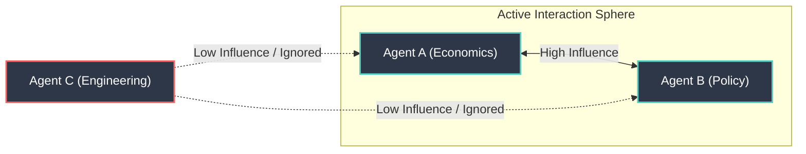
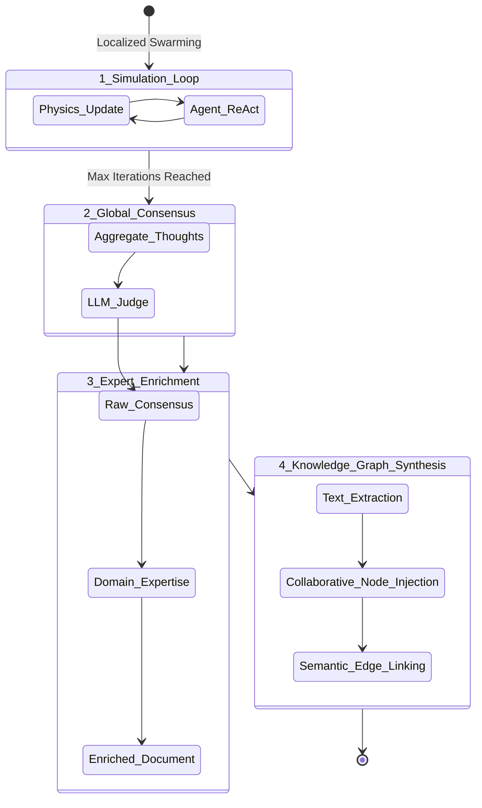

# Murmur Swarm: An Elevator Pitch

**Murmur Swarm** is an advanced Multi-Agent System (MAS) that reimagines how Large Language Models (LLMs) collaborate. Instead of using rigid, turn-based round-robins or chaotic fully-connected networks, Murmur Swarm places agents in a **simulated 3D physical environment** governed by the kinematics of flocking behaviors (the Boids algorithm). 

By using physical proximity to dictate which agents can "hear" each other, the system naturally models attention, fosters dynamic sub-debates, and drastically reduces token-bloat—all while organically driving the swarm toward a highly rigorous consensus.

---

## The Core Innovation: Spatial Cognition

In traditional MAS, if you have 10 agents, every agent often has to process the thoughts of the other 9. This leads to context saturation and severe API cost burn. 

In Murmur Swarm, agents only exchange context if their spatial simulation boundaries overlap. Information attenuates exponentially over distance via an **Influence Matrix**.

An idea initiated by one agent must physically ripple through the swarm to gain momentum. Sub-groups can fracture, debate locally, and merge back into the main cluster, naturally filtering out noise and surfacing the most resilient ideas.

---

## High-Level System Flow

The entire ecosystem is orchestrated using a deterministic LangGraph state machine that binds chaotic LLM generation to reliable software loops.

### 1. The Physics Engine
A Boids algorithm drives agent movement. Agents seek out peers (**Cohesion**), match their topical flow (**Alignment**), avoid getting stuck in identical thought loops (**Separation**), and remain tethered to the global prompt (**Goal Seeking**). 

### 2. The Cognitive Loop
When agents physically overlap in the simulation, their internal LLM prompts are dynamically injected with the thoughts they "heard." They query a local Vector Retrieval system for contextual Knowledge Graphs, process their private memories, and generate an independent response (ReAct loop). 

### 3. Consortium Vote & Expert Enrichment
Once the physical simulation hits its iteration limit, the Orchestrator forces a global vote. An LLM acts as an impartial judge to extract a single **Raw Consensus**. Then, it sequentially routes this text back through the agents. Each expert (e.g., an Astrophysicist, a Software Architect) injects deep, domain-specific rigor into the document without overwriting their peers.

### 4. Collaborative Knowledge Graphing
The final output is not just a block of text. The swarm autonomously extracts a foundational taxonomy, and agents cooperatively build a structured JSON Knowledge Graph by injecting granular nodes. Finally, a semantic pass weaves disparate concepts together, outputting machine-readable intelligence ready for future Retrieval-Augmented Generation (RAG).

---

## Why Murmur Swarm?

- **Extreme Token Efficiency**: Spatial gating limits input windows natively, breaking the $O(N^2)$ scaling problem seen in multi-agent routing.
- **Organic Debate**: Ideas face "local scrutiny" before infecting the broader swarm.
- **Deep Technical Rigor**: The sequential expert enrichment pipeline guarantees that a generalized consensus evolves into a deeply technical, multifaceted research document.
- **Self-Structuring Memory**: Generates fully-linked Knowledge Graphs autonomously, giving the swarm persistent, structured chronological memory.
