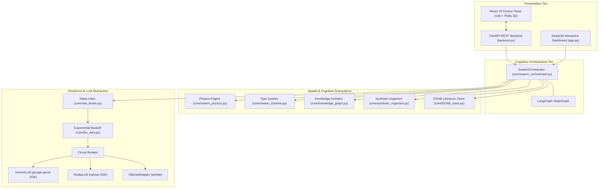
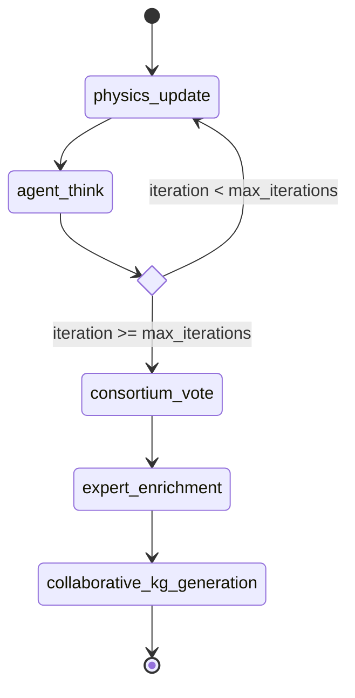

# Murmur Swarm Architecture

**Murmur Swarm** orchestrates multiple Large Language Models (LLMs) interacting within a virtual 3D spatial physics environment. The system integrates traditional deterministic state machines with generative cognitive loops to emulate emergent collective intelligence inspired by natural starlings (murmurations).

---

## 1. High-Level Architecture Overview

The system architecture is decoupled into distinct modules organized under `core/`, served by dual interface options (FastAPI + React 19 Control Tower and Streamlit), with an integrated academic RAG layer:

### Module Responsibilities

1. **Orchestrator ([`core/swarm_orchestrator.py`](file:///Users/mike/Documents/code/Murmur_swarm/core/swarm_orchestrator.py))**: Central simulation coordinator managing the LangGraph state machine, provider dispatch, parallel/sequential thought loops, consortium voting, and collaborative graph generation.
2. **Physics Engine ([`core/swarm_physics.py`](file:///Users/mike/Documents/code/Murmur_swarm/core/swarm_physics.py))**: 3D spatial simulation implementing Reynolds Boids dynamics (Separation, Alignment, Cohesion, Goal Seeking) and computes distance-attenuated auditory influence matrices.
3. **Core Schema & Type System ([`core/swarm_schema.py`](file:///Users/mike/Documents/code/Murmur_swarm/core/swarm_schema.py))**: Pydantic v2 models defining `Vector3`, `AgentConfig`, `ChatMessage`, `AgentRuntimeState`, and `SwarmSnapshot`.
4. **Knowledge Architect ([`core/knowledge_graph.py`](file:///Users/mike/Documents/code/Murmur_swarm/core/knowledge_graph.py))**: In-memory TF-IDF and Cosine similarity semantic search, BFS topological sub-graph expansion, document parsing via MarkItDown, and 3-phase collaborative graph synthesis.
5. **Synthetic Organism Governor ([`core/synthetic_organism.py`](file:///Users/mike/Documents/code/Murmur_swarm/core/synthetic_organism.py))**: Implements Invariant Manifold Anchoring (IMA), Topology-Aware Retrieval Morphing (TARM), Homeostatic Metabolic Governor (HMG), Epistemic Validation Gate (EVG), and manifold curvature tearing evaluation.
6. **Provider & Resilience Layer**:
   - [`core/swarm_gemini.py`](file:///Users/mike/Documents/code/Murmur_swarm/core/swarm_gemini.py): Google Gemini integration via modern `google-genai` SDK.
   - [`core/swarm_nvidia.py`](file:///Users/mike/Documents/code/Murmur_swarm/core/swarm_nvidia.py): NVIDIA NIM cloud endpoints via AsyncOpenAI.
   - [`core/swarm_ollama.py`](file:///Users/mike/Documents/code/Murmur_swarm/core/swarm_ollama.py): Local inference via asynchronous HTTP REST (`aiohttp`).
   - [`core/rate_limiter.py`](file:///Users/mike/Documents/code/Murmur_swarm/core/rate_limiter.py): Shared sliding-window token and request throttling (RPM/TPM).
   - [`core/llm_retry.py`](file:///Users/mike/Documents/code/Murmur_swarm/core/llm_retry.py): Exponential backoff decorator targeting transient HTTP/LLM errors.
7. **Literature Ingestion ([`core/DOAB_client.py`](file:///Users/mike/Documents/code/Murmur_swarm/core/DOAB_client.py))**: Directory of Open Access Books API client enabling automated peer-reviewed book discovery, retrieval, and ingestion into the swarm memory.
8. **Storage & Serialization ([`core/swarm_io.py`](file:///Users/mike/Documents/code/Murmur_swarm/core/swarm_io.py))**: Manages persistence for snapshots, agent configurations, live states, markdown conclusions, and JSON knowledge graphs.

---

## 2. The LangGraph State Machine

The simulation lifecycle is driven by a directed cyclic state graph maintained by LangGraph, ensuring determinism, observability, and state persistence.

### State Scope (`SwarmSnapshot`)
The `SwarmSnapshot` represents the globally immutable frame at any simulation tick $t$:
- `simulation_id`: Unique run identifier.
- `iteration`: Current tick index.
- `max_iterations`: Simulation ceiling.
- `universal_prompt`: Root research objective.
- `agent_configs`: Registry of immutable agent definitions (`AgentConfig`).
- `agent_states`: Dynamic positions, velocities, private memories, and latest thoughts (`AgentRuntimeState`).
- `influence_matrix`: Pre-computed pairwise auditory weights $I(r, s)$ derived from 3D Euclidean distances.

### Execution Cycle

1. **`physics_update`**: Calculates Boids forces, clamps velocities to `max_speed`, steps positions via Euler integration, and recalculates the Influence Matrix with quadratic distance attenuation.
2. **`agent_think`**: Asynchronously fans out across all active agents. Each agent:
   - Identifies peers within auditory proximity ($I(r, s) > 0.05$).
   - Formulates a combined search query and executes in-memory TF-IDF + Cosine similarity retrieval against its local Knowledge Graph.
   - Performs Breadth-First Search (BFS) topological expansion on matching nodes.
   - Generates an updated internal thought using the active LLM provider through rate-limited channels.
3. **`check_termination`**: Conditional edge checking whether `iteration >= max_iterations`.
4. **`consortium_vote`**: Synthesizes all final agent thoughts into a master consensus paper using an LLM consensus judge.
5. **`expert_enrichment`**: Routes the consensus paper back to each agent (sequentially or in parallel) to enrich the paper with domain-specific methodologies, formalisms, and critiques without overwriting peer contributions.
6. **`collaborative_kg_generation`**: Decomposes the final enriched paper into structured concepts and atomic facts, performs agent expansion passes, and establishes cross-domain semantic links.

---

## 3. Dual Interface Architecture

Murmur Swarm provides two complementary execution modes:

### Modern Control Tower (FastAPI + React 19)
- **Backend ([`backend.py`](file:///Users/mike/Documents/code/Murmur_swarm/backend.py))**: Async FastAPI REST application serving endpoints for simulation control, agent management, DOAB book ingestion, knowledge graph browsing, and live log broadcasting.
- **Frontend ([`frontend/`](file:///Users/mike/Documents/code/Murmur_swarm/frontend/))**: Modern React 19 + TypeScript + Vite SPA featuring interactive 3D WebGL scatter plots ([Plotly.js](file:///Users/mike/Documents/code/Murmur_swarm/frontend/package.json)), timeline scrubbers, agent forge, and telemetry panels.
- **Launcher ([`run_app.py`](file:///Users/mike/Documents/code/Murmur_swarm/run_app.py))**: Single-command startup verifying Python packages, building frontend assets, and launching the server on `http://localhost:8501`.

### Streamlit Control Tower ([`app.py`](file:///Users/mike/Documents/code/Murmur_swarm/app.py))
- Single-script dashboard providing rapid prototyping, live simulation controls, and 3D visual playback.
