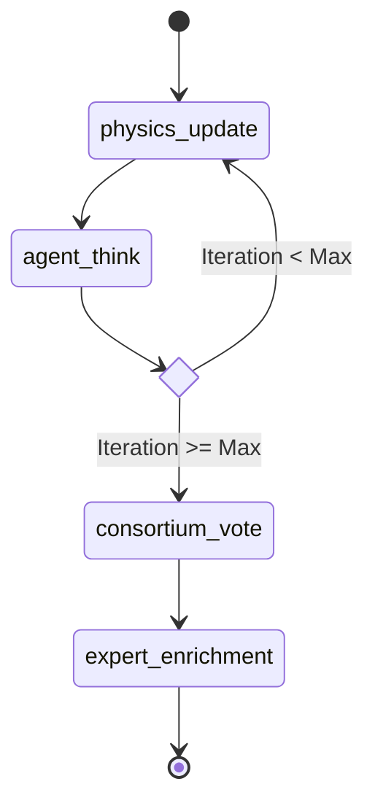

# Murmur Swarm Architecture

Murmur Swarm orchestrates multiple LLMs (Large Language Models) interacting in a virtual spatial environment. The system merges traditional computational state machines with dynamic, generative AI loops to emulate emergent properties seen in natural swarms.

## High-Level Architecture Overview

The system architecture is decoupled into several highly specialized domains:

1. **Orchestrator (`swarm_orchestrator.py`)**: The central brain of the operation. It manages the execution lifecycle using **LangGraph** to model the state machine.
2. **Physics Engine (`swarm_physics.py`)**: A spatial simulation environment that uses a Boids-derived model to govern agent position, velocity, and dynamic interaction ranges.
3. **Agent Ecosystem (`swarm_schema.py`)**: Pydantic models defining the strong typing of the `SwarmSnapshot`, agent states, and configurations.
4. **Knowledge Architect (`knowledge_graph.py`)**: Handles context retrieval, vector embeddings (via FAISS or similar), and the synthesis of continuous conversational data into semantic graphs.
5. **Provider Layer (`swarm_gemini.py`, `swarm_ollama.py`, `swarm_nvidia.py`)**: Abstractions over various LLM APIs allowing hot-swapping between local models and cloud providers natively.

## The LangGraph State Machine

The heart of the simulation is a directed state graph maintained by LangGraph. It ensures fault-tolerant, trackable state transitions iteratively over time.

### State Scope (`SwarmSnapshot`)
The SwarmSnapshot represents the globally immutable frame at any given time $t$. It includes:
- `iteration`: Current tick value.
- `agent_states`: The 3D vectors mapping the positions, velocities, and latest thoughts of all active agents.
- `influence_matrix`: The pre-computed list of "who can hear whom" calculated purely by physical dynamics.

### Execution Nodes

The workflow executes in a strict topology:

1. **`physics_update`**: Calculates the separation, alignment, and cohesion forces. Updates $x,y,z$ positions and rebuilds the `influence_matrix`.
2. **`agent_think`**: This is an asynchronous fan-out process. Every agent simultaneously looks at the `influence_matrix`. If an agent is in range of others, it injects their last thoughts into its local context alongside its own private memory and retrieved KG concepts. It then queries the LLM structure to produce its *next* thought.
3. **`check_termination`**: A conditional edge. If the maximum number of iterations has not been hit, the simulation loops back to `physics_update`.
4. **`consortium_vote`**: Once the loop ends, the orchestrator pulls all final thoughts and asks the LLM to synthesize a baseline consensus.
5. **`expert_enrichment`**: Finally, agents sequentially enrich the synthesized text using their defined `domain` and `interaction_style`.

By structuring the simulation as a Graph, Murmur Swarm abstracts the concurrency of multi-agent LLM requests away from the complex synchronization of analog physics simulations.
