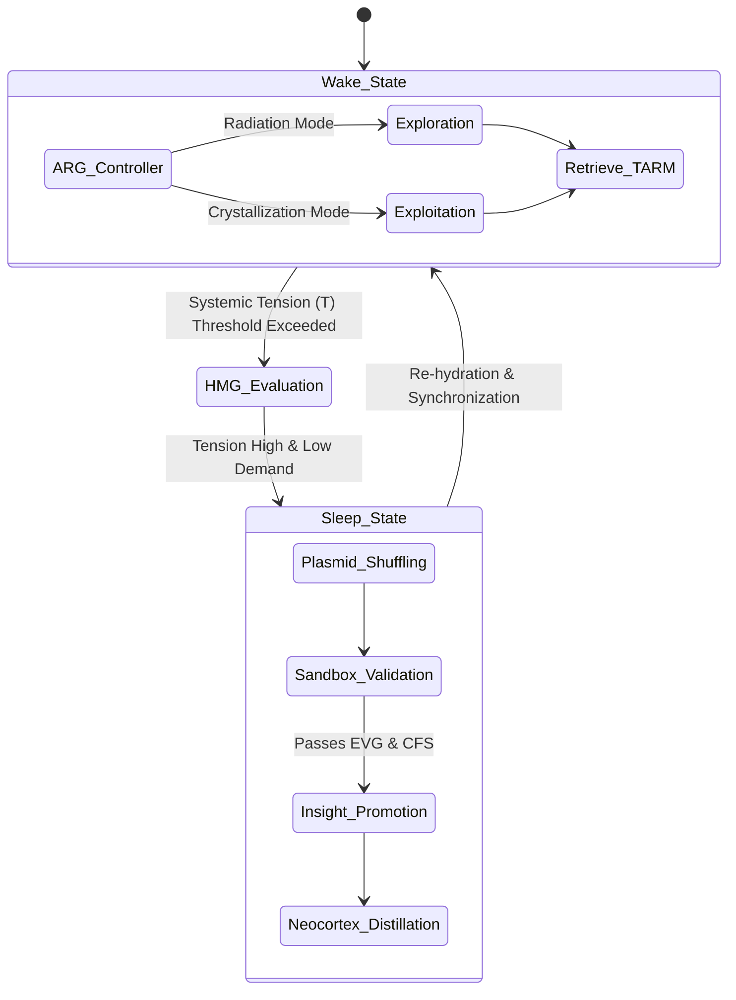
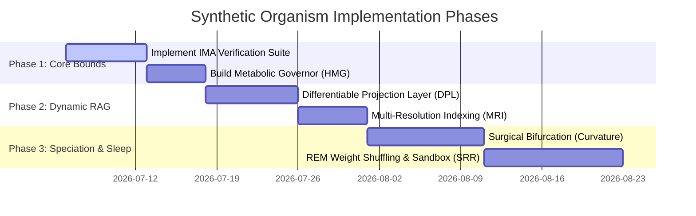

# Technical Specification: Tripartite "Synthetic Organism" Cognitive Architecture

This document provides a detailed technical specification to translate the theoretical concepts in [conclusion_2026-07-05_17-16-51.md](file:///Users/mike/Documents/code/Murmur_swarm/swarm_data/conclusions/conclusion_2026-07-05_17-16-51.md) into actionable, modular Python code.

---

## 1. System Architecture Overview

The system transitions from a static multi-agent loop to a **Self-Regulating Cognitive Ecosystem** operating in two primary states: **Wake-State** (exploratory reasoning and execution) and **Sleep-State** (consolidation, recombination, and pruning).



---

## 2. Invariant Manifold Anchoring (IMA)

### Concept
Prevents **Catastrophic Representational Drift** by anchoring the agent's core axioms to a frozen Reference Manifold ($\mathcal{M}_{Ref}$).

### Actionable Python Implementation
1.  **Axiom Reference Store**: A static file containing core ethical, logical, and structural constraints that cannot be modified.
2.  **Golden Evaluator Suite**: A set of $N$ benchmark queries with expected semantic outputs.
3.  **Lagrangian Topological Constraint**: Evaluated via KL-Divergence. If any new weight adjustments (or prompt adaptations) drift beyond a threshold, the update is rejected.

```python
import numpy as np

class InvariantManifoldAnchor:
    def __init__(self, golden_embeddings: np.ndarray, tolerance: float = 0.05):
        # M_Ref: Golden anchor embeddings of core axioms
        self.reference_manifold = golden_embeddings
        self.tolerance = tolerance

    def verify_update(self, new_embeddings: np.ndarray) -> bool:
        """
        Ensures representation drift does not exceed the Lagrangian constraint.
        Computes the cosine distance divergence between M_Ref and the new manifold mapping.
        """
        distances = []
        for ref, new in zip(self.reference_manifold, new_embeddings):
            cosine_dist = 1.0 - (np.dot(ref, new) / (np.linalg.norm(ref) * np.linalg.norm(new)))
            distances.append(cosine_dist)
        
        mean_drift = np.mean(distances)
        return mean_drift <= self.tolerance
```

---

## 3. Topology-Aware Retrieval Morphing (TARM)

### Concept
Adapts retrieval in lockstep with the agent's internal geometric updates, preventing the RAG index from falling out of sync with evolving representations.

### Actionable Python Implementation
1.  **Differentiable Projection Layer (DPL)**: Instead of re-embedding the entire corpus, we train a lightweight projection matrix (Affine Map) mapping $\mathcal{E}_{old} \rightarrow \mathcal{M}_{new}$.
2.  **Catabolic Index Pruning (CIP)**: Uses $K$-Means clustering to group highly redundant embeddings and replaces them with a single centroid.
3.  **Multi-Resolution Indexing (MRI)**: Modulates retrieval bounds depending on the Allostatic Rhythm Governor (ARG) state:
    *   *Radiation mode*: Expanded search radius (low similarity threshold, high recall).
    *   *Crystallization mode*: Narrow search radius (high similarity threshold, high precision).

```python
import numpy as np
from sklearn.cluster import KMeans

class DifferentiableProjectionLayer:
    """Maps legacy embedding space to the evolved manifold using NumPy least squares."""
    def __init__(self, dim: int = 768):
        self.dim = dim
        self.W = np.eye(dim)  # Initialize as Identity matrix
        self.b = np.zeros(dim)

    def fit(self, X_old: np.ndarray, X_new: np.ndarray):
        """Fits an affine transformation mapping X_old -> X_new."""
        # Append column of ones to X_old to solve for bias together with weights
        X_design = np.hstack([X_old, np.ones((X_old.shape[0], 1))])
        # Solve least-squares: X_design * beta = X_new
        beta, _, _, _ = np.linalg.lstsq(X_design, X_new, rcond=None)
        self.W = beta[:-1, :]
        self.b = beta[-1, :]

    def forward(self, x: np.ndarray) -> np.ndarray:
        return np.dot(x, self.W) + self.b

class CatabolicPruner:
    """Collapses redundant embedding vectors into centroids to save VRAM."""
    def __init__(self, n_clusters: int):
        self.kmeans = KMeans(n_clusters=n_clusters, random_state=42)

    def collapse_index(self, embeddings: np.ndarray) -> np.ndarray:
        self.kmeans.fit(embeddings)
        return self.kmeans.cluster_centers_
```

---

## 4. Speciation and Cladogenesis

### Concept
Spawns specialized clades ( Mixture of Experts) when local regions of the manifold tear (exceed local curvature thresholds).

### Actionable Python Implementation
1.  **Riemannian Metric Divergence (Surgical Bifurcation)**: Monitors the covariance matrix rank of local node neighborhoods. A drop in effective rank indicates a topological gap requiring a clade.
2.  **Hyper-Dimensional Computing Router**: Converts clade signatures into bipolar holographic vectors to select clades in $O(1)$ time.

```python
import numpy as np
import scipy.linalg as la

def evaluate_manifold_tearing(local_embeddings: np.ndarray, curvature_threshold: float = 1.8) -> bool:
    """
    Approximates local manifold curvature using singular value decay.
    Tearing is flagged if local rank collapses while distance remains high.
    """
    if len(local_embeddings) < 5:
        return False
    
    # Compute local singular values
    U, S, Vt = la.svd(local_embeddings - np.mean(local_embeddings, axis=0))
    effective_rank = np.sum(S > 1e-5)
    
    # Calculate singular value entropy as curvature proxy
    normalized_s = S / np.sum(S)
    sv_entropy = -np.sum(normalized_s * np.log2(normalized_s + 1e-9))
    
    return sv_entropy < curvature_threshold
```

---

## 5. Homeostatic Metabolic Governor (HMG)

### Concept
Limits cognitive expansion using physical resource thresholds (VRAM, latency, Variational Free Energy), forcing catabolic precision downgrades.

### Actionable Python Implementation
1.  **Systemic Tension ($\mathcal{T}$)**: Evaluated as a function of VRAM capacity and latency metrics.
2.  **Tiered precision hibernation**: Automatically down-casts weights of inactive clades (FP16 $\rightarrow$ INT8 $\rightarrow$ NF4) and scales weight sizes globally.

```python
import os
import resource
import numpy as np

class HomeostaticMetabolicGovernor:
    def __init__(self, ram_max_bytes: int):
        self.ram_max = ram_max_bytes

    def get_systemic_tension(self) -> float:
        # Get resident set size (RSS) memory usage of the process in bytes
        # On macOS, ru_maxrss is in bytes
        rss_bytes = resource.getrusage(resource.RUSAGE_SELF).ru_maxrss
        return rss_bytes / self.ram_max

    def apply_synaptic_scaling(self, weights: np.ndarray, tension: float) -> np.ndarray:
        """Globally scales weight sizes when systemic tension is high."""
        if tension > 0.85:
            gamma = 0.9  # Scale factor
            return weights * gamma
        return weights

    def quantize_weights(self, weights: np.ndarray) -> np.ndarray:
        """Simulates NF4/INT8 precision down-cast using 8-bit integer scaling."""
        max_val = np.max(np.abs(weights))
        if max_val == 0:
            return weights.astype(np.int8)
        scale = 127.0 / max_val
        return np.round(weights * scale).astype(np.int8)
```

---

## 6. Synthetic REM-State Recombination (SRR)

### Concept
An offline sleep cycle that stochastically shuffles weight deltas (plasmids) from unrelated clades, validating them in a sandbox.

### Actionable Python Implementation
1.  **Synthetic Adversarial Sandbox (SAS)**: Evaluates shuffled candidate plasmids against core axioms.
2.  **Epistemic Validation Gate (EVG)**: If the plasmid increases utility without degrading core logic (evaluated via KL), it is synthesized into the reference neocortex.

```python
class EpistemicValidationGate:
    def __init__(self, test_axioms: list):
        self.test_axioms = test_axioms

    def validate_insight(self, candidate_agent, baseline_performance: float) -> bool:
        """
        Runs candidate agents against test queries.
        Insight is validated only if task performance increases and axioms hold.
        """
        violations = 0
        utility_score = 0.0
        
        for axiom in self.test_axioms:
            response = candidate_agent.evaluate_axiom(axiom)
            if response.violates_constraints:
                violations += 1
            utility_score += response.accuracy_score
            
        mean_utility = utility_score / len(self.test_axioms)
        return (violations == 0) and (mean_utility > baseline_performance)
```

---

## 7. Implementation Roadmap



---

## 8. Recommended Library Stack & Rationale

To implement the architecture efficiently without introducing bloated or unverified dependencies, we recommend the following library selections:

| Layer / Mechanism | Recommended Library | Rationale |
| :--- | :--- | :--- |
| **Topological Metrics & Betti-1** | `networkx` & `scipy` | Already in `requirements.txt`. Computes Betti-1 ($Edges - Vertices + Components$) and uses sparse solvers (`scipy.sparse.linalg.eigs`) to calculate Spectral Radius (largest eigenvalue) without requiring heavy compiled TDA frameworks like `giotto-tda`. |
| **Projection Mapping (DPL)** | `numpy` & `scikit-learn` | Uses closed-form least squares (`np.linalg.lstsq`) to compute optimal affine projection matrices. Avoids installing `torch` (PyTorch), which does not currently have stable wheels for Python 3.14 on macOS. |
| **Precision Quantization (HMG)** | `numpy` | Avoids complex binary wrappers like `bitsandbytes` (which fail on Python 3.14) by using simulated 8-bit quantization transformations natively in NumPy. |
| **Optimal Transport (MTP)** | `POT` (Python Optimal Transport) | Installed successfully. Highly optimized library for solving linear programming transport problems. Essential for aligning source and target agent manifolds during plasmid transfer in the Manifold Translation Protocol. |
| **Semantic Compression (CIP)** | `scikit-learn` | Already in `requirements.txt`. Provides the `KMeans` implementation for collapsing high-density clusters into Concept Centroids. |
| **Index Traversal & Storage** | `pymilvus[milvus_lite]` | Already in `requirements.txt`. Native Python vector storage supporting metadata filtration, ideal for tracking node visitation counts and executing local sub-manifold queries. |
| **Hyper-Dimensional Gating** | `numpy` | Already in `requirements.txt`. Implements binary bipolar holographic vectors using standard bitwise operators (`XOR`, `popcount`) on dense boolean arrays. |
