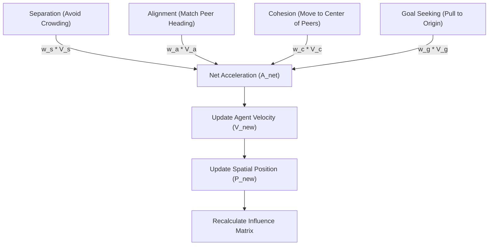

# Theoretical Underpinnings of Murmur Swarm

Murmur Swarm introduces a novel approach to Multi-Agent Systems (MAS) by coupling Large Language Model (LLM) cognitive loops with a continuous, 3D spatial physics engine. Instead of a traditional round-robin or fully-connected broadcast network, agent communication is mediated by simulated physical proximity and movement.

This approach draws inspiration from **swarming behaviors in nature** (like flocks of birds or schools of fish) and translates those spatial dynamics into **attention and context-routing mechanisms** for artificial intelligences.

## The Boids Model as a Cognitive Router

At the core of the spatial engine is a modified **Boids algorithm** (originally developed by Craig Reynolds in 1986). The physics engine computes forces acting on each agent at every time step ($dt$) inside `swarm_physics.py`.

The net acceleration an agent experiences is a weighted sum of four vectors:
$$ \vec{A}_{net} = (w_s \cdot \vec{V}_s) + (w_a \cdot \vec{V}_a) + (w_c \cdot \vec{V}_c) + (w_g \cdot \vec{V}_g) $$

1. **Separation ($\vec{V}_s$)**: Agents avoid crowding neighbors. This ensures cognitive diversity by preventing agents from clumping together in identical context spaces.
   $$ \vec{V}_s = \sum_{j \neq i} \frac{\vec{P}_i - \vec{P}_j}{|\vec{P}_i - \vec{P}_j|^2} $$

2. **Alignment ($\vec{V}_a$)**: Agents steer towards the average heading of peers. This represents adopting the flow of a conversational topic.
   $$ \vec{V}_a = \left( \frac{1}{N} \sum_{j \neq i} \vec{V}_j \right) - \vec{V}_i $$

3. **Cohesion ($\vec{V}_c$)**: Agents steer towards the average position of peers, encouraging group cohesion and shared context.
   $$ \vec{V}_c = \left( \frac{1}{N} \sum_{j \neq i} \vec{P}_j \right) - \vec{P}_i $$

4. **Goal Seeking ($\vec{V}_g$)**: A magnetic pull towards the origin $(0,0,0)$, acting as a tether to the central global prompt or task at hand, preventing agents from drifting indefinitely.
   $$ \vec{V}_g = \vec{P}_{goal} - \vec{P}_i $$

**Updating State Kinematics**
Once the net acceleration $\vec{A}_{net}$ is computed, the continuous spatial state is updated via Euler integration, clamped by a defined maximum speed to maintain stability:
$$ \vec{V}_{i}(t+1) = \max_{clamp}(\vec{V}_i(t) + \vec{A}_{net} \cdot dt, \text{max\_speed}) $$
$$ \vec{P}_i(t+1) = \vec{P}_i(t) + \vec{V}_i(t+1) \cdot dt $$

## Spatial Attenuation of Information (Influence Matrix)

In a fully connected LLM multi-agent system, token limits are quickly reached, and context becomes noisy. Murmur Swarm solves this by using spatial distance to gate information transfer.

After every physics update, an **Influence Matrix** is recalculated. The influence score representing how loudly Agent A "hears" Agent B is dictated by an inverse-square decay function:

$$ Influence(A, B) = \frac{1}{1 + \alpha \cdot d^2} $$

where $d$ is the Euclidean distance between $A$ and $B$, and $\alpha$ is a decay coefficient. 

If this score falls below a certain threshold (e.g., $0.05$), or if the distance exceeds the maximum `visual_range`, the connection is severed for that iteration. 

### Why this matters theoretically:
- **Dynamic Topologies**: The network graph of "who is talking to whom" changes fluidly over time. Sub-groups can form, debate locally, and then merge back into the main swarm.
- **Context Economy**: Agents only process the thoughts of their immediate neighbors, drastically reducing token usage and focusing the LLM on localized, relevant debates.
- **Emergent Consensus**: Ideas propagate through the physical space like ripples. An idea initiated by one agent must physically overlap with others to gain momentum, naturally surfacing the most resilient ideas.
