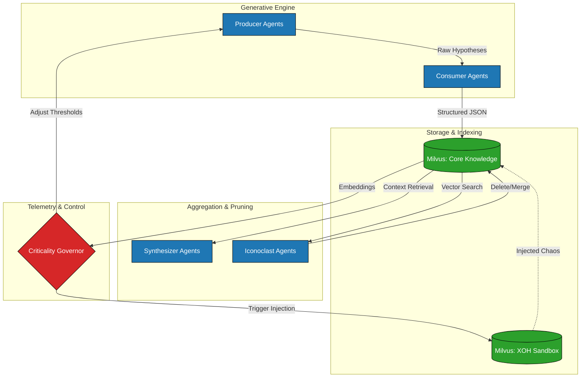
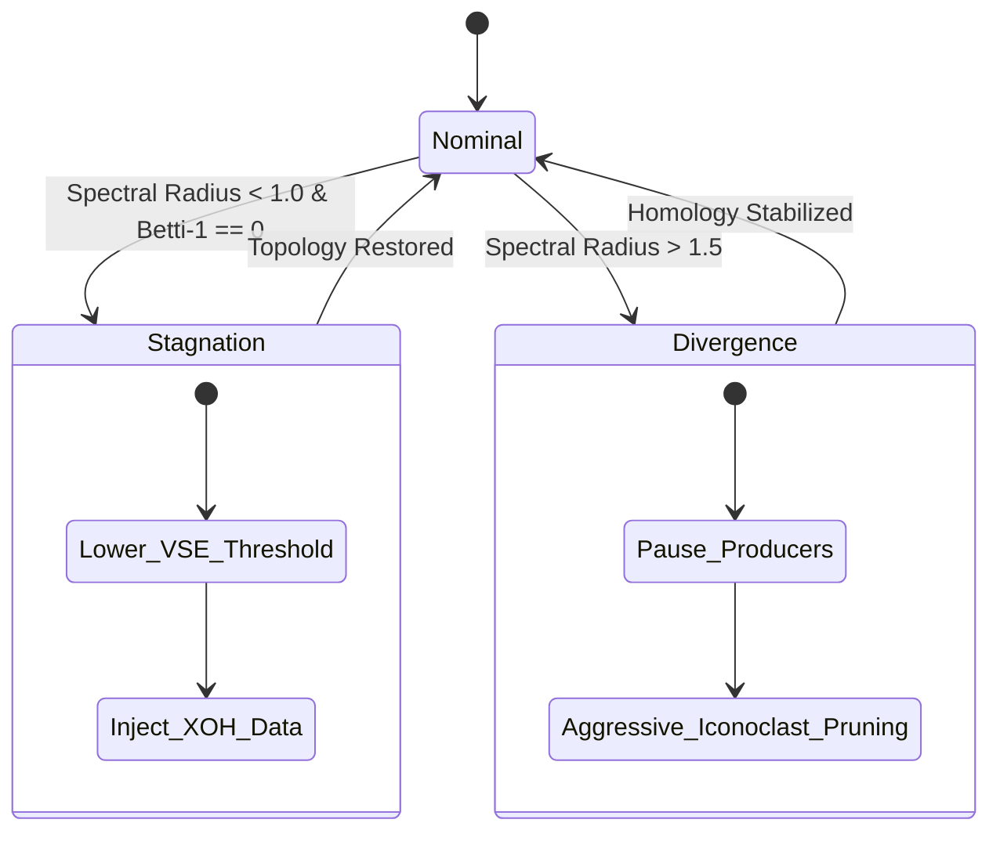

# Multi-Agent AI (MAAI) System

This directory contains the concrete Python implementation of the **Multi-Agent AI (MAAI) System**, a framework designed to overcome static convergence and semantic collapse in Large Language Model (LLM) networks.

By combining autonomous agent loops, high-dimensional vector databases, and Topological Data Analysis (TDA), the MAAI system establishes a continuous exploration engine that balances novelty (divergence) with structural integrity (convergence).

---

## 🧠 Theoretical Overview

Standard LLM workflows, particularly Retrieval-Augmented Generation (RAG) and recursive summarization loops, suffer from **"Static Convergence."** Over time, the system continuously reinforces a narrow subset of highly probable concepts, failing to explore novel or out-of-distribution ideas. 

To solve this, the MAAI system conceptualizes knowledge as a **dynamic, evolving topology**. It regulates this topology using two core principles:

1. **Void-State Epistemology (VSE)**: A masking technique that hides highly-frequented knowledge nodes, forcing the generative models into unexplored semantic spaces ("the void").
2. **Xeno-Ontological Hospitium (XOH)**: A sandboxed environment containing highly adversarial or random data. When the system becomes too rigid, it injects "chaos" from the XOH to shatter the stagnation.

---

## 🏗️ System Architecture

The system is built upon four distinct agent layers that interact continuously with a central Milvus Vector Database.



### The Agent Layers

1. **Producer (Exploration)**: Runs at high frequencies with high temperature (`gemini-2.5-flash`). Its sole purpose is to hallucinate, hypothesize, and generate varied outputs.
2. **Consumer (Filtration)**: Takes the chaotic output of the Producer, strictly enforces schemas via Pydantic, filters out complete nonsense, and structures it into an `EpistemicNode`.
3. **Synthesizer (Aggregation)**: Runs at lower frequencies (`gemini-2.5-pro`). It utilizes Context Caching to read massive batches of database nodes and form unified structural theories.
4. **Iconoclast (Pruning)**: Operates purely on the database level via cosine similarity. It hunts down redundant nodes (similarity > 0.95) and circular logic loops, pruning them to maintain structural hygiene.

### Criticality Governor (Telemetry)

The Governor observes the **shape** of the knowledge database using Topological Data Analysis (`giotto-tda`) and graph theory (`scipy`).



- **Spectral Radius Proxy**: Measures how densely packed the knowledge nodes are.
- **Betti-1 Numbers (H1)**: Measures the number of "holes" or structural loops in the topology. 

If the system is **Stagnant** (too dense, no holes), it forces exploration. If the system is **Divergent** (fragmenting into chaos), it aggressively prunes and pauses production.

---

## 💻 Practical Implementation

### File Structure

- `models.py`: Pydantic data schemas enforcing the structure of the `EpistemicNode`.
- `database.py`: Connects to local `Milvus Lite` and manages the vector collections.
- `agents.py`: Contains the asynchronous implementation of the four agent layers using the `google-genai` SDK.
- `governor.py`: Contains the math and matrix calculations for evaluating the system's topological health.
- `ui.py`: A Streamlit dashboard utilizing `umap-learn` and `plotly` to visualize the Milvus database in 3D real-time.

### How to Run

1. **Install Dependencies**
   ```bash
   pip install -r requirements.txt
   ```

2. **Initialize Vector Database**
   This script creates the `core_knowledge` and `xoh_sandbox` collections locally via Milvus Lite.
   ```bash
   python experimental/maai_system/database.py
   ```

3. **Launch the Control Tower UI**
   Ensure your Gemini API key is exported in your environment.
   ```bash
   export GEMINI_API_KEY="your-google-api-key"
   streamlit run experimental/maai_system/ui.py
   ```

### Using the UI

The Streamlit UI provides a 3D visualization of the `core_knowledge` database. 
- Use the sidebar to input a "Seed Context" and click **Run Producer Loop**.
- This asynchronously triggers a Producer and a Consumer, generating new nodes, embedding them via `text-embedding-004`, and inserting them into Milvus.
- Once at least 3 nodes are present, the UI will automatically project their 768-dimensional embeddings down to 3 dimensions using **UMAP** and plot them dynamically.
- The UI will also display the real-time Telemetry metrics calculated by the Governor.
